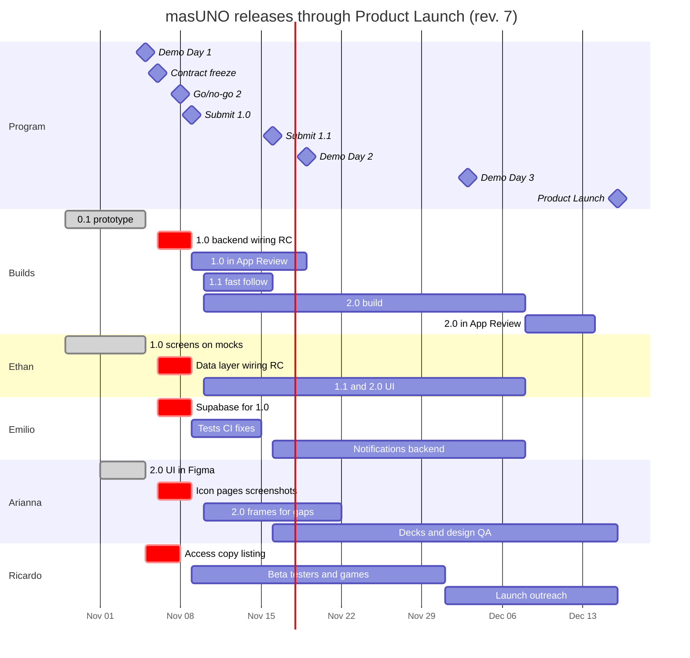

# masUNO iOS — Project Specification

**Rev. 7 · 2026-11-05** · replaces rev. 6 (Nov 3), `PLAN.md` (rev. 2) and earlier revisions. Rev. 7 records what's done, keeps the 1.0 submission on **Mon Nov 9** by moving all remaining backend work into Fri–Sun Nov 6–8, and adds the **2.0 UI** from the new Figma (§7.7).
**Team:**
- **Ethan Wen** — frontend: the iOS app's screens, view logic and App Store submission; **for 1.0 also the Swift data layer** (rev. 7, N21).
- **Emilio** — backend: Supabase (tables, rules, RPCs, functions, jobs, email, notifications).
- **Arianna** — design: Figma, app icon, website pages, decks, screenshots, design QA.
- **Ricardo** — team lead and outreach: users, beta testers, hosts, copy, demo days, launch.

**Program:** App Accelerator: Startup to 1000 — Demo Day #1 **Thu Nov 5**, Demo Day #2 **Thu Nov 19**, Demo Day #3 **Thu Dec 3**, Product Launch **Wed Dec 16**

**Status today (Thu Nov 5):**
- **Frontend (1.0 UI) is built on mock data and merged to `main`** (PRs #4–#7): design system, map + popup, game form, location picker, event detail, safety, Me, Settings, temp onboarding, group chat screen, Saved, calendar/invite/Google Maps, edit profile, Padel, iPad / iPhone Duo layout. Nothing talks to Supabase yet.
- **Backend has not started in the repo:** `supabase/` and `MasUno/Data/` are still placeholders, `docs/API.md` and `docs/QA.md` are empty, and there are no repository protocols yet. Every Emilio card on Trello is open. (If `masuno-dev` already exists in the Supabase dashboard, it isn't reflected anywhere we can see.)
- **2.0 UI is designed:** the Figma file "masuno figma" now has per-sport flows (basketball, tennis, soccer, volleyball, padel), group chat for each sport, Me and Settings, plus `DESIGN.md` v2.0 in the project. This is the 2.0 look (§7.7); what's built is the 1.0 look.
- `com.masuno.app` registered on the Boys & Girls Clubs of Chicago developer team (Oct 28). The app icon set is still empty.

> **How to read this.** §0–§6 are the plan: releases, scope, calendar, who does what, how we work. §7–§9 are the product and technical spec (§7.1–§7.6 = 1.0 UI, §7.7 = 2.0 UI). §10–§13 are release steps, risks, decisions and what comes after. Items marked **⚑** need sign-off (§12).
>
> **IDs:** **E** = Ethan, **B** = backend (Supabase is Emilio's; B5–B7 are Ethan's for 1.0), **D** = Arianna (design), **O** = Ricardo (outreach).
>
> **Status words** in §5: **Done** (merged / delivered) · **Built** (on mock data, needs live wiring) · **To do** · **Not confirmed** (no evidence in the repo, Figma or Trello — owner please update).
>
> **Estimates** are focused build hours for one developer working with AI coding tools, including self-testing, excluding program sessions and code review.
>
> **Times:** program sessions are 5:00–6:30 pm Central (6:00–7:30 pm Eastern for Ethan).

---

## 0. Summary

- **Two UI versions** (rev. 7, N23):
  - **1.0 UI** = what's built today (green design system, SF Pro, blue pins, §7.1–§7.6). It ships in 1.0 and 1.1 as is.
  - **2.0 UI** = the new Figma + `DESIGN.md` v2.0 (sport colors, court headers, "+1" open-spot tokens, rounded type, §7.7). It ships in 2.0.
  - Where the two disagree, the built app wins for 1.x and the Figma wins for 2.0.
- **Builds:**
  - **Build 0.1 — Demo Day #1 (Nov 5):** the redesigned app on mock data, on TestFlight (internal).
  - **1.0 — submitted Mon Nov 9** (unchanged, N20): the real app on `masuno-prod` with Tec sign-in, hosting, joining and everything App Review requires. The backend, the data layer and the release candidate all happen Fri–Sun Nov 6–8 (§4.1). The same build goes to the external TestFlight beta (Sun Nov 8). Aim: live before Demo Day #2 (Nov 19).
  - **1.1 — fast follow, submitted Mon Nov 16:** review and beta fixes, plus anything cut from 1.0. 1.0 UI. Also the hard backstop for 1.0 if it slips on Sun Nov 8.
  - **2.0 — after Demo Day #3:** the 2.0 UI, notifications, synced Saved games, Spanish and polish. Beta Tue Dec 1, submitted Tue Dec 8, live for the Product Launch (Dec 16).
- **Coders, split for 1.0** (N21):
  - **Emilio** builds Supabase only: tables, rules, RPCs, auth hook, Gmail email, safety, delete-account, prod.
  - **Ethan** builds everything in Swift, including the data layer (`AuthService`, `GameStore`, live repositories), because his screens are done and the backend is the critical path.
  - They meet at one contract (§8.5, `docs/API.md`) and the Swift repository protocols (E1), now due **Fri Nov 6 at noon**.
- **Hours left:** Ethan ≈ 61 h (31 h for 1.0, 30 h for 2.0); Emilio ≈ 54 h (30 h for 1.0, 24 h for 2.0); plus group-chat messaging as a stretch for both. **Emilio's ~27 h of 1.0 Supabase work by Sun Nov 8 morning — about 9 h a day, Fri to Sun — is the critical path** (K1); Ethan's ~31 h of data layer, wiring and release work runs alongside it.
- **Arianna (~5 h/week)** has finished the 2.0 look in Figma. By Sun Nov 8 she delivers the app icon (Fri), the website pages (Sat) and 1.0 screenshots (Sun). After that she draws the screens the 2.0 Figma doesn't have yet (onboarding, states, safety, notifications) in the 2.0 style.
- **Ricardo (~5 h/week)** gets people:
  - Supabase access for Emilio and the team Gmail first — both still unconfirmed and blocking; needed tonight.
  - Tec test inboxes, venues, beta testers, hosts and real games.
  - The policy and App Store copy, Spanish translation, demo-day stories and numbers.
  - The launch push and moderation.
- **No domain, no custom email.** Sign-in codes come from a team Gmail; the policy and support pages live on `masuno-app.github.io`; report alerts go to the team chat; both Supabase projects stay on the free plan.

---

## 1. What changed

### This revision (rev. 7, Nov 5)

| # | Change | Why | Sign-off |
| - | --- | --- | --- |
| N20 | **1.0 still submits Mon Nov 9.** Nothing backend is in the repo yet, so all remaining 1.0 work moves into Fri–Sun Nov 6–8: contract freeze Fri noon, backend core Sat, go/no-go #2 Sun noon, RC + Beta App Review Sun evening (§4.1). If sign-in, join or delete account isn't live on prod by Sun noon, 1.0 submits the day they are, with Mon Nov 16 as the hard backstop. | Team plan (Nov 5): review waits are long, so submit as early as possible. A mock build can't pass review (2.1). | ⚑ Ricardo, Emilio (weekend hours) |
| N21 | **Ethan owns the Swift data layer for 1.0:** `AuthService` (B5), `GameStore` (B6), live repositories (B7) and the instant block hiding in `GameStore` (part of B8). Emilio stays on Supabase. Reverses N7 for 1.0; Emilio keeps `NotificationService` (B16) in 2.0. | Ethan's 1.0 screens are done; this halves Emilio's critical path. Rev. 6's balancing rule already pointed this way. | ⚑ Emilio |
| N22 | **Contract freeze moves to Fri Nov 6 (noon).** E1 is marked Done on Trello but isn't in the repo (screens still use `SportsEvent`/`EventStore`), so it's reopened. `docs/API.md` is due the same day. | Nov 4 freeze was missed; B3 and B5–B7 build against it. | — |
| N23 | **Two UI versions.** Everything built today is the **1.0 UI** (§7.1–§7.6, green Figma frames `341:*`). The new Figma and `DESIGN.md` v2.0 are the **2.0 UI** (§7.7), built in 2.0 as E27. If they conflict, 1.x follows the build and 2.0 follows the Figma. | Keeps the Nov 16 build stable; gives the redesign a release of its own. | Decided (Ethan, Nov 5) |
| N24 | **2.0 UI vs locked decisions:** a few Figma details conflict with earlier decisions (interests on Who's going, calendar-sync and name-visibility rows in Settings, "Delete game", "· Read" receipts, mic glyph, font). Listed in §7.7.6 with defaults; signed off as R7-4 to R7-10. | The 2.0 frames shouldn't quietly undo privacy and scope decisions. | ⚑ Arianna, Ricardo |
| N25 | **D2 (frames for screens built from the spec) is now drawn in the 2.0 style and built in 2.0**, merged with D8. 1.0 ships those screens as built from §7.5–§7.6. 1.1 no longer swaps in onboarding frames. | No point drawing 1.0-style frames that 2.0 replaces a month later. | — |
| N26 | **1.1 stays the Mon Nov 16 fast follow** and doubles as the backstop if 1.0 slips. It no longer swaps in onboarding frames (N25). | Keeps the Nov 9 build small. | — |
| N27 | **Release blockers found in the code** added to E14 and §10.4: Settings shows "Privacy & Terms — Coming soon"; the chat composer says "Messages are coming soon"; Invite shares an App Store *search* link; the mock location at Tec; the empty app icon; Delete account isn't wired. | Each one is an App Review 2.1 or 5.1.1(v) risk. | — |
| N28 | **Auto-repost (N17) look:** the 2.0 Figma has no toggle and no "Reposted …" line yet. 1.0 ships the built toggle and line (1.0 UI); Arianna draws it in the 2.0 style (D11 → 2.0). The bump pin ("Spot open") still needs building (E25). | Built on mocks; the server half is in B3. | — |
| N29 | **Trello is behind:** the 1.0 list still says "submit Sat Nov 21", most card dates are rev. 5's, and Ricardo/Arianna/Emilio cards show no progress. Each owner updates their cards to §5 at the Fri Nov 6 go/no-go (§6). | The plan only works if status is visible. | — |

### Rev. 6 (still in force unless changed above)

| # | Change | Why | Sign-off |
| - | --- | --- | --- |
| N11 | *(Date kept by N20: Mon Nov 9.)* Submit 1.0 early; build 0.9 folded into 1.0; one release candidate goes to App Review and the external TestFlight beta on the same days. | App Store Connect review waits are long. | ⚑ |
| N12 | *(Dates moved by N20 into Fri–Sun Nov 6–8.)* 1.0 needs the live backend — a mock-data build can't pass review (report, block and delete account must really work; guideline 2.1). | Follows from N11. | ⚑ Emilio |
| N13 | 1.1 fast follow (Mon Nov 16) takes anything cut from 1.0 (§3 cut order). | Keeps the 1.0 build small. | — |
| N14 | **Group chat in 1.0, with a fallback.** The chat screen stays as built; real messaging (Chat v1, Appendix A) is a 1.0 stretch goal (B20 + E26). **If messaging isn't live on prod by the Sun Nov 8 release candidate, the submitted build drops the composer and mock messages** and ships the read-only game hub (§7.6.9). | A disabled "coming soon" composer or fake messages would be rejected under 2.1. | Decided (team, Nov 3) |
| N15 | Bookmarks + Saved list in 1.0, stored on the phone only. Syncing and "Notify me if a spot opens" in 2.0 (B15, E17). | Already built. | — |
| N16 | Add to calendar, Invite a friend, Google Maps option (E19) and Past games + Edit profile & interests (E21) in 1.0. Edit profile needs `complete_profile` live; otherwise it moves to 1.1. | Already built. | — |
| N17 | Auto-repost in 1.0 (MVP): host toggle (on by default) that bumps a game when a full game frees a spot. Backend in B3 (§7.6.11, §8.3, §8.5). | Hosts want traction, not a manual bump. | Decided (team, Nov 3) |
| N18 | Onboarding is built from §7.5 copy. *(Frames now come with the 2.0 UI, N25.)* | Unblocks 1.0. | — |
| N19 | Padel as a fifth sport (game form, map filter, interests). Backend: `padel` in the `activities` seed (B1). | Team decision Nov 3. **Done in the app (PR #6).** | Emilio (B1 seed) |

### Rev. 5 (still in force)

| # | Change | Why | Sign-off |
| - | --- | --- | --- |
| N6 | **Roles:** Ethan frontend, Emilio backend, Arianna design, Ricardo outreach. All work in §5 re-assigned. | Team decision. | — |
| N7 | *(Changed by N21 for 1.0: Ethan builds the Swift data layer.)* **Split at the data layer:** Emilio owns `AuthService`, the repositories and `GameStore` (Swift), not just the database. | Keeps Supabase knowledge in one head and evens out the coders' hours (otherwise Ethan would carry ~105 h). | — |
| N8 | **Supabase access:** Ricardo's organization stays the owner (rev. 2 decision 10), but Emilio is added as an **Owner** of it; or Ricardo transfers the organization to Emilio. | The backend developer needs full control (billing-free plan, secrets, members). | ⚑ |
| N10 | **Repo setup task (E0)** for Ethan, due Nov 1: access, branch protection, folders, config template, `CODEOWNERS`, PR template, README. `CODEOWNERS` moves from B11 to E0. | Emilio can't start B1 until the repo is ready for two coders. | — |
| N9 | **Design leads the build:** Arianna delivers frames for each screen before Ethan builds it (§4.2), and reviews screenshots in UI PRs. | Rev. 4 had no designer; several 1.0 screens have no frame. | — |

### Rev. 4 (still in force)

N1 builds at each demo day, 1.0 before Demo Day #3, 2.0 after it, launch Dec 16 · N2 smaller 1.0, notifications and polish in 2.0 · N3 no domain or custom email (Gmail SMTP, GitHub Pages, team-chat alerts, free Supabase) · N4 one-page Privacy & Terms.

### From rev. 2 (carried over)

| # | Change | Why | Sign-off |
| - | --- | --- | --- |
| C1 | Releases with fixed scope replace the open backlog. | Rev. 2 ≈ 95 dev-days; about 16 are available. | — |
| C2 | *(Reversed by N14: group chat in 1.0, read-only fallback.)* **No chat screen** during the program; meet-up spot and Who's going live on Event detail. Chat v1 design kept in Appendix A. Reverses decision 3. | A disabled "Messages are coming soon" composer invites an App Review 2.1 rejection; hub + timeline costs ~8 h. | ⚑ |
| C3 | *(Timing changed by N16: in 1.0.)* **"Add to Calendar" button** (EventKitUI, no permission prompt) in 2.0 instead of calendar sync. Reverses decision 14. | 1.5 h instead of ~16 h; edited games don't update the calendar entry. | ⚑ |
| C4 | **No profile photos** during the program; initials avatars. | No storage, upload or image moderation. | ⚑ |
| C5 | **Names show as "First L."** (e.g. "Emilio G.") to others; no name-visibility setting. | Privacy-forward default, no settings screen. | ⚑ |
| C6 | Notifications in **2.0**. | Biggest single item (~19 h) and needs an APNs key (created in the B&GC developer account). | ⚑ |
| C7 | Notification outbox drained by a 1-minute `pg_cron` job. | Batching and retries in one place. | — |
| C8 | `profiles` (public card) split from `profile_private` (own row only). | Fixes rev. 2's RLS: views couldn't read the host's name. | — |
| C9 | `events.going_count` stored, with `check (going_count <= capacity)`. | Correct counts with blocks; overbooking impossible. | — |
| C10 | `events.ends_at` set by trigger. | `timestamptz + interval` can't be a generated column. | — |
| C11 | Location asked when the map first opens; notifications (2.0) after the first join or hosted game. | Better grant rates; shorter onboarding. | — |
| C12 | App Review uses a hidden **demo campus** with auto-refreshed games. | Reviewers always see joinable games; real users never see fake ones. | — |
| C13 | Apple account: B&GC team; all four of us already have access. Still needed for 2.0: an APNs key. | `com.masuno.app` registered Oct 28. | — |
| C14 | Raise Supabase's auth-email limit (30/hour default with custom SMTP). | A demo-day or launch post could exceed 30 sign-ups an hour. | — |
| C15 | Metrics from one SQL view + App Store Connect; no analytics SDK. | Demo-day numbers at ~2 h cost. | — |
| C16 | Minimum-version gate in 1.0. | Lets 2.0 force an update if needed. | — |
| C17 | `supabase/` lives in the `ios` repo. | One PR can change client and database together. | — |

**Still locked from rev. 2:** Supabase; @tec.mx email codes only; sports only (Basketball, Tennis, Soccer, Volleyball, Padel — N19); no organizer approval; Tec de Monterrey; English first with strings externalized; venue search + pin + current location; 7-day posting window; light mode only; sign-in gates the app; no skill level; soft cancel; separate dev and prod projects.

---

## 2. Goals & release criteria

**Goals**
1. A build to show at every demo day; 1.0 submitted Mon Nov 9 and on the App Store before Demo Day #2 (Nov 19) if review allows, Demo Day #3 at the latest (Demo Day #2 runs from the external TestFlight beta if review is still pending); 2.0 on the App Store for the Product Launch.
2. A Tec student can sign up, find or post a game, join it and know where to show up, in under 2 minutes from install.
3. Pass App Review's user-generated-content rules: agree to guidelines, text filter, report, block, act on reports within 24 h, contact info in the app, in-app account deletion.
4. Numbers for each demo day: beta testers, verified sign-ups, games hosted, joins, games that filled.

**Not in scope during the program:** photos, calendar sync, dark mode, Android/web, organizer approval, recurring games, non-sport activities, other campuses, our own domain or branded email.

**Release criteria for 1.0 and 2.0**
- Core loop works on two physical phones against `masuno-prod`, including two people racing for the last spot.
- App Review checklist (§10.4) all green.
- 1.0: no crash in the Sun Nov 8 two-phone QA pass. 2.0: no crash in the last 3 days of TestFlight (Xcode Organizer).
- Every user-facing string in the String Catalog; VoiceOver can complete the core loop (full accessibility pass in 2.0).
- 1.0: Arianna has checked the RC against the green `341:*` frames and this spec (differences noted). 2.0: each screen matches its 2.0 frame (§7.7) or the difference is noted.

**Demo-day targets** (testers, sign-ups, games) are set by Ricardo (O1, still open) and reported before each demo day (O10).

---

## 3. Releases & scope

| Build | UI | Channel | Shown at | Contents |
| --- | --- | --- | --- | --- |
| **0.1 Prototype** | 1.0 | TestFlight (internal) | Demo Day #1, Thu Nov 5 | Green design system and every 1.0 screen. Mock data. |
| **1.0** | 1.0 | App Store (release on approval) + external TestFlight beta, both submitted Sun–Mon Nov 8–9 | Demo Day #2, Thu Nov 19 (live, or from TestFlight if review is slow) | Everything in "1.0 scope" below, on `masuno-prod`. |
| **1.1** | 1.0 | App Store, release on approval, Mon Nov 16 | Demo Day #3, Thu Dec 3 | Review/beta fixes; anything cut from 1.0. |
| **2.0 beta** | 2.0 | TestFlight | Demo Day #3 (sneak peek) | 2.0 UI + notifications and synced Saved working end to end. |
| **2.0** | 2.0 | App Store, manual release | Product Launch, Wed Dec 16 | Everything in "2.0 scope" below. |

### 1.0 scope (submit Mon Nov 9)
**Must work live — the App Review checklist (§10.4); never cut:**
- Email-code sign-in for @tec.mx; App Review password path; onboarding (6 screens, guidelines agreement); suspended-account and update-required screens.
- Map from the database: pins with "Soon", popup, recenter, campus fallback when location is off or > 15 km away (reviewers aren't in Monterrey).
- Game form: add/edit with server validation; Where's the game? (search + current location); meet-up spot; cancel game.
- Event detail (all six states), join/leave with server-enforced capacity and optimistic UI, Who's going.
- Safety: report person or game, block/unblock, Blocked people, text filter, report alerts, bans.
- Settings: Location, Blocked people, Community guidelines, Privacy & Terms (live link, not "Coming soon"), Contact us, version, Sign out, **Delete account (really deletes)**.
- App icon; no placeholders, "coming soon" text, DEBUG menus, mock data or mock location in the Release build.

**Also in 1.0 (already built; cut to 1.1 in the order below if they aren't live on dev by Sat Nov 7 evening):** Me (Going, Hosting, Past), group chat (N14 — messaging if B20 + E26 land, otherwise read-only), bookmarks + Saved list on the phone (N15), Add to calendar, Invite a friend, Google Maps option, Edit profile & interests (N16), map search and sport filter, basic empty/error/offline states.

**Auto-repost (N17) is MVP:** the toggle and hosting-card line are built; the server bump (B3) and the bumped pin (E25) must be live by Sun Nov 8 noon — raise it at the Sat Nov 7 evening check if not. It is not on the cut list, but the toggle can't ship as a dead setting.

### 2.0 scope
- **2.0 UI (§7.7, E27):** sport colors, court/field headers with the player lineup, "+1" open-spot tokens, sport-tinted pins/popups/Me cards/chat, rounded type, new copy ("Count me in", "Room for N more"), Settings icon tiles, form suggestion chips; plus 2.0-style frames for screens the Figma doesn't have yet (D2/D8).
- Notifications: a spot opened (Saved games), game changed, game cancelled, 30-min reminder, new game matching your interests, host updates; Notifications section in Settings; permission asked after the first join or hosted game.
- Saved synced to the account (B15), "Notify me if a spot opens" on full games.
- Spanish localization (strings, dates, sport names, notification text).
- Location picker drag-to-adjust; "Happening now" state; "changed since you joined" banner.
- "A spot opened" push to people who saved a game (pairs with auto-repost).
- Group chat messaging, if it missed 1.0 (B20, E26, Appendix A).
- Full accessibility pass; metrics view; fixes from 1.0 feedback.

### After the program (§13)
Chat push and retention, profile photos, calendar sync, name-visibility setting, dark mode, links that open a specific game, organizer approval, recurring games, non-sport activities, new campuses, own domain/email.

### Cut order if we slip
- **1.0 → 1.1**, decided at the Sat Nov 7 evening check and again at the Sun Nov 8 noon go/no-go: (1) Edit profile & interests; (2) group chat — first fall back to read-only (drop the composer and mock messages), then hide its entry points if even that isn't live; (3) Invite a friend; (4) Past games; (5) sport filter; (6) map search; (7) offline banner (keep retry). Hide cut features in the Release build — never ship a button that does nothing.
- **If sign-in, join or delete account isn't live on prod by Sun Nov 8 noon:** don't submit a mock build. Keep going and submit the day they're live (aim Tue–Wed Nov 10–11); hard backstop Mon Nov 16 together with 1.1. Demo Day #2 then shows the TestFlight build, labelled as beta.
- **2.0** — (1) form suggestion chips and join animation (§7.7); (2) Google Maps option; (3) drag-to-adjust; (4) "changed since you joined" banner; (5) host-update notifications; (6) court art simplified to a plain sport-color band with the lineup tokens (keeps the rest of the 2.0 UI).
- **Never cut** anything on the App Review checklist.

---

## 4. Timeline

### 4.1 Key dates

The submission stays on **Mon Nov 9**. All remaining 1.0 work happens Fri–Sun Nov 6–8, so the backend, the data layer and the release candidate run in parallel all weekend.

| Date | Milestone | Exit check |
| --- | --- | --- |
| Sat Oct 31 → **overdue** | Access | Emilio is an Owner on the Supabase organization (O2); team Gmail exists (O3). Neither is confirmed — **must be done tonight (Thu Nov 5)**. |
| Sun Nov 1 | Kickoff | Repo ready (E0) ✅. §12 decisions and demo-day targets (O1) still open. |
| Tue Nov 3 | Rev. 6 | Frontend PRs merged ✅ (#5, #6). |
| Wed Nov 4 | ~~Contract freeze~~ · Build 0.1 | Contract missed → Fri Nov 6. UI pass merged ✅ (#7). 0.1 upload not confirmed (E6). |
| **Thu Nov 5** | **Demo Day #1** · Rev. 7 | Build 0.1 on a real phone. O2 + O3 done tonight. Rev. 7 shared in the team chat. |
| **Fri Nov 6** | **Contract freeze** (noon) · Dev up · **Go/no-go #1** (evening) | Noon: `docs/API.md` + E1 protocols, models and mocks merged. Evening: `masuno-dev` exists and seeds (B1); auth hook + review accounts on dev (B4); `GameStore` on mock repositories (B6); latency test (O5) and policy copy (O6) in; app icon (D3). Call: everyone confirms they can work the weekend (R7-1, R7-2). |
| **Sat Nov 7** | Backend core | Noon: `create/update/cancel/join/leave_game` + `game_cards` on dev (B3 part 1); a real code reaches a Tec inbox (B2); `masuno-prod` created (B12). Evening: report, block, text filter, demo campus, auto-repost on dev (B3 part 2); `AuthService` (B5) and live repositories (B7) working against dev; Privacy & Terms + Support pages live (D4); listing copy in App Store Connect (O7). **Evening check:** apply the cut order (§3). |
| **Sun Nov 8** | **Go/no-go #2** (noon) · Release candidate (evening) | Morning: safety backend (B8), delete-account (B9), migrations + demo campus + review accounts on prod; live wiring done (E24, E25, E14). **Noon:** on prod, the app signs in, creates, joins, leaves, cancels, reports, blocks and deletes the account — or submission slips (§3). Afternoon: two-phone QA (`docs/QA.md`); screenshots (D7). Evening: Release build uploaded and sent to Beta App Review; §10.4 all green. |
| **Mon Nov 9** | **Submit 1.0** | Released on approval. |
| Nov 10–13 | In review | Rejection → reply and resubmit within 24 h. Last resubmit to be live for Demo Day #2: **Fri Nov 13**. External beta opens when Beta App Review clears (O8). Database tests + CI (B10, B11) by Thu Nov 12. |
| **Mon Nov 16** | Submit 1.1 | Review/beta fixes + anything cut from 1.0. **Also the hard backstop for 1.0** if it slipped on Sun Nov 8. |
| **Thu Nov 19** | **Demo Day #2** | 1.0 live (or TestFlight if review is still pending); first metrics. |
| Nov 25–27 | Thanksgiving break | No program sessions; light work only. |
| **Tue Dec 1** | 2.0 beta | 2.0 UI + notifications working in TestFlight. |
| **Thu Dec 3** | **Demo Day #3** | 1.x live; 2.0 beta shown. |
| **Tue Dec 8** | **Submit 2.0** | Manual release. |
| **Fri Dec 11** | 2.0 resubmit cutoff | — |
| **Mon Dec 14** | Release 2.0 | Or the moment it's approved, if later. |
| **Wed Dec 16** | **Product Launch** | 2.0 live; waitlist email sent; launch deck. |

**Weekend hour by hour (Fri Nov 6 – Sun Nov 8).** Both coders keep a shared note of what's live on dev, and nobody waits on a review for more than 4 hours.

| | Ethan | Emilio | Arianna | Ricardo |
| --- | --- | --- | --- | --- |
| **Fri** morning | E1 protocols + models + mocks; pair with Emilio on `API.md` | `API.md`; B1 `masuno-dev` + `supabase init` + seed | App icon (D3) | Venue list (O5); Tec inboxes (O4) |
| **Fri** afternoon/evening | `GameStore` on mocks (B6) | Auth hook + allowlist + review accounts (B4); start B3 tables | Website pages (D4) | Latency test (O5); policy + support copy (O6); go/no-go call |
| **Sat** morning | `AuthService` (B5) on dev as soon as B4 is up | B3 part 1 (games RPCs, `game_cards`); Gmail SMTP (B2); create `masuno-prod` (B12) | D4 pages live | Listing copy (O7) |
| **Sat** afternoon/evening | Live repositories (B7) + live wiring (E24) | B3 part 2 (report, block, filter, demo campus, auto-repost, `game_activity`) | DD2 deck can wait — rest | Enter listing + URLs in App Store Connect; recruit beta testers (O8) |
| **Sun** morning | E24/E25 finish; release hygiene (E14) | Safety alerts + bans (B8); delete-account (B9); migrations, demo campus and review accounts on prod | — | Moderation rota posted (O11) |
| **Sun** noon | **Go/no-go #2** — everyone | | | |
| **Sun** afternoon/evening | Two-phone QA; upload RC; Beta App Review | Fix what QA finds on the server side | Two-phone QA; screenshots (D7) | Two-phone QA |
| **Mon** | **Submit 1.0** (E15) | On call | — | — |

### 4.2 Week by week

Program weeks shown; the Wednesday Team Session doubles as our weekly sync.

| Week | Ethan (frontend + Swift data layer) | Emilio (Supabase) | Arianna (design) | Ricardo (outreach) |
| --- | --- | --- | --- | --- |
| **Done** (Oct 29–Nov 4) | Repo (E0); design system (E2); every 1.0 screen on mocks (E3–E13, E17, E19, E21); padel; iPad/Duo layout | — (nothing in the repo yet) | 2.0 UI in Figma (all five sport flows, group chat ×5, Me, Settings) + `DESIGN.md` v2.0 | Not confirmed |
| **Wk 7** (Nov 2–8) · DD1 Thu · **1.0 RC Sun** | 0.1 on TestFlight (E6); contract + protocols (E1); `GameStore` (B6); `AuthService` (B5); live repositories (B7); live wiring (E24, E25); release hygiene (E14); RC + QA Sun | **Everything for 1.0, Fri–Sun:** dev setup (B1), auth hook (B4), Gmail SMTP (B2), schema/RPCs (B3), safety (B8), delete-account (B9), prod + demo campus (B12) | DD1 deck (D5); app icon (D3) Fri; Privacy & Terms + Support pages (D4) Sat; screenshots (D7) + 1.0 design QA (D6) Sun | **O2 + O3 Thu night**; Tec inboxes (O4), venues + latency test (O5), policy copy (O6) Fri; listing (O7) Sat; kickoff decisions + targets (O1) |
| **Wk 8** (Nov 9–15) · **submit 1.0 Mon** | Submit 1.0 (E15); answer review; 1.1 fixes; start 2.0 UI (E27: tokens, pins, popup, Me cards) | Database tests (B10), CI (B11), fixes from review; chat backend (B20) if it missed 1.0 | Resolve 2.0 conflicts (D12) Wed; start 2.0 frames for missing screens (D2/D8) | Beta testers once Beta App Review clears (O8); moderation (O11) |
| **Wk 9** (Nov 16–22) · submit 1.1 Mon · DD2 Thu | Submit 1.1 Mon; 2.0 UI: court headers, detail, chat, Who's going (E27) | 2.0 backend start: notification backend (B13) | DD2 deck (D5); 2.0 frames for missing screens (D2/D8) by Sun; 2.0 tokens as Figma variables (D13) | Beta + real games (O8, O9); DD2 numbers (O10) |
| **Wk 10** (Nov 23–29) · Thanksgiving | 2.0: notification screens (E16), Saved sync (E17), restyle onboarding/safety/states from D2 frames (E27) | `send-push` (B14), Saved backend (B15), `NotificationService` (B16) | Design QA of 1.x release | Spanish translation (O12); beta feedback summary (O8) |
| **Wk 11** (Nov 30–Dec 6) · DD3 Thu | 2.0 beta Tue; Spanish (E18), picker drag + banner (E20), 1.x fixes | Metrics (B17), Spanish notifications (B18), 1.x fixes | DD3 deck (D5); 2.0 design QA (D6); Spanish layout check (D9) | DD3 story + numbers (O10) |
| **Wk 12** (Dec 7–13) | Accessibility + tests (E22); submit 2.0 Tue (E23) | Notification tests, prod checks (B19) | 2.0 screenshots (D7); launch deck (D5) | Launch-week games (O9); PR/FAQ final; launch plan (O13) |
| **Wk 13** (Dec 14–16) | Release 2.0 Mon | On call | Product Launch | Waitlist email + launch posts (O13); on call |



---

## 5. Work split

For 1.0, everything in Swift is Ethan's (screens and the data layer); everything in `supabase/` is Emilio's. The contract in §8.5 (`docs/API.md`) and the Swift repository protocols (E1) are the interface. Ethan and Emilio review each other's PRs; Arianna reviews screenshots in PRs that change a screen.

**Status as of Thu Nov 5**, from the repo (`main` @ `96b270c`), the Figma file and Trello. "Not confirmed" means nothing visible yet — the owner updates Trello by Fri Nov 6.

### 5.1 Ethan — frontend + Swift data layer

| ID | Work | Release | Est. | Due | Status | Done when |
| --- | --- | --- | --- | --- | --- | --- |
| E0 | Repo setup (§6). | 0.1 | 2 h | Nov 1 | **Done** (#4) | Emilio clones, builds and opens a PR blocked until Ethan approves. |
| E1 | **Contract + domain models** with Emilio: `Profile`/`PersonSummary`, `Activity`, `Place`, `Game`, `DomainError`; `AuthService`, `GameRepository`, `ProfileRepository`, `SafetyRepository` protocols + mocks. | 1.0 | 3 h | **Fri Nov 6 (noon)** | **To do** — Trello says Done, but no protocols in the repo; screens use `SportsEvent`/`EventStore` | Protocols merged; B3 and B5–B7 build against them. |
| E2 | Green design system (§7.1); colors in the asset catalog; String Catalog; DEBUG gallery. | 0.1 | 6 h | Nov 4 | **Done** (#5, #7) | No hard-coded colors in views. |
| E3 | Navigation shell (§7.3) + update-required + suspended screens; `masuno://game/<id>`. | 0.1 | 2 h | Nov 4 | **Done** | All routes reachable. |
| E4 | Map + popup redesign (341:1979, 341:2046), incl. iPad / iPhone Duo layout. | 0.1 | 5 h | Nov 4 | **Done** (#5, #7) | Matches the frames on mock data. |
| E5 | Onboarding (§7.5) + suspended screen. | 1.0 | 4 h | Sat Nov 7 | **Built** (temp, mock auth) | Signs in for real once B5 lands. 2.0 restyles it from D2 frames. |
| E6 | Build 0.1 to TestFlight. | 0.1 | 1 h | Nov 5 | **Not confirmed** | On TestFlight for Demo Day #1. |
| E7 | Game form add/edit/cancel, validation. | 1.0 | 6 h | — | **Built** | Create/edit/cancel round-trip on `masuno-dev` (via E24). |
| E8 | Where's the game?: search + current location. | 1.0 | 3 h | — | **Built** | Spot set by search or by location. |
| E9 | Live map: location prompt, campus fallback (> 15 km) + banner, pull to refresh; remove the mock location. | 1.0 | 3 h | Sun Nov 8 | **Built on mocks**; `LocationService.mockCoordinate` TEMP | Map shows real games; App Review (far away) lands on campus. |
| E10 | Event detail (§7.6.4). | 1.0 | 7 h | — | **Built** | Each state reachable with DEBUG launch arguments; last-spot race shows the right message on two phones. |
| E11 | Safety screens (§7.6.6). | 1.0 | 5 h | — | **Built** | Blocked person's games and name vanish without refreshing. |
| E12 | Me: Going, Hosting. | 1.0 | 4 h | — | **Built** | Matches 341:2165/341:2240 (1.0 version). |
| E13 | Settings + Delete account. | 1.0 | 2.5 h | Sun Nov 8 | **Built**; Privacy & Terms row says "Coming soon"; delete not wired (B9) | Delete account signs you out and the account is gone. |
| E14 | **States + release hygiene**: empty/error/offline basics; app icon; launch color; Release → prod; DEBUG-only demo tools (`-screen`, gallery, `simulateDropOut`); **remove "Coming soon" text, the disabled chat composer (unless E26), the App Store search invite link, the mock location** (N27); hide cut features. | 1.0 | 3 h | Sun Nov 8 | **To do** | Release build has no DEBUG menus, mock data, placeholder text or dead buttons; airplane mode never strands a screen. |
| E15 | Submit 1.0: privacy label, age rating, review notes; Ricardo enters the listing (O7). | 1.0 | 2 h | **Mon Nov 9** | To do | 1.0 submitted. |
| B5 | **`AuthService` (Swift)** — *moved to Ethan (N21)*: send/verify code, password path, session persistence, expired-session and suspended detection, `complete_profile` + `accept_guidelines`. | 1.0 | 4 h | Sat Nov 7 | To do | Onboarding signs in for real on `masuno-dev`. |
| B6 | **`GameStore` (Swift)** — *moved to Ethan (N21)*: `@Observable`, `LoadState`, optimistic join/leave + rollback, error-code → `DomainError`, instant local hiding after a block; replaces `EventStore`; remove `SkillLevel`, `Venue`, `Person.you`. | 1.0 | 5 h | Fri Nov 6 | To do | Store unit tests green on mock repositories. |
| B7 | **Live repositories** (`supabase-swift` v2) — *moved to Ethan (N21)*: games, profiles, safety; `ActivityCatalog` cached with a built-in fallback of the 5 sports. | 1.0 | 6 h | Sat Nov 7 | To do | Mock ↔ live is a one-line switch. |
| E24 | **Live wiring**: move screens onto E1 models + `GameStore`/`AuthService`; delete `EventStore`/`MockData` from Release; group chat on live data — messaging if B20 + E26 land, otherwise the read-only fallback (N14); Saved persisted on the phone (N15). | 1.0 | 6 h | Sun Nov 8 (morning) | To do | Every 1.0 screen works on `masuno-dev` with no mock data. |
| E25 | **Auto-repost** (N17): form toggle, hosting-card line, bumped pin ("Spot open", drawn on top for 2 h), bumped games first in search; wired to `auto_repost` / `reposted_at`. | 1.0 | 1.5 h | Sun Nov 8 | **Built on mocks** (toggle + "Reposted …" line); bump pin to do (0.5 h) | Player leaves a full game → host card shows "Reposted just now" and the pin is bumped on another phone. |
| E26 | **Group chat messaging** (stretch, N14): send with optimistic insert + retry, live updates, unread counts, text filter, report a message. | 1.0 stretch | 4 h | Sat Nov 7 | **UI built** (mock messages, disabled composer) | Two phones exchange messages on prod — or the RC has no composer. |
| E19 | Add to Calendar, Invite a friend, Google Maps option. | 1.0 | 2.5 h | — | **Built**; invite link TEMP (App Store search URL → real app URL in E14) | Calendar editor opens prefilled with no permission prompt; invite shares the app's App Store link. |
| E21 | Me: Past games + Edit profile & interests. | 1.0 | 3 h | — | **Built** (save is mock until B7) | Edited interests save and reload from the server. |
| E17 | Saved: local list (1.0) **built**; sync + Notify me (2.0). | 1.0 / 2.0 | 1.5 h | Nov 29 | Local version **built** | Saved survives reinstall; Notify me works. |
| | *1.0 remaining* | | *~31 h + 4 h stretch* | | *~48 h already built* | |
| E27 | **2.0 UI pass** (§7.7, N23): 2.0 tokens + rounded type (2 h); sport colors on pins, popup with tail, "+1" tokens (2 h); court/field headers ×5 with the lineup and "Room for N more" (4 h); Me cards + profile band (1.5 h); chat sport band, bubbles, join pill (1.5 h); Who's going rows, Settings icon tiles, form suggestion chips, copy (1 h); restyle onboarding/safety/states from D2 frames. | 2.0 | 12 h | Tue Dec 1 (start Nov 10) | — | 2.0 beta matches the 2.0 frames (or differences noted by Arianna). |
| E16 | Notification screens. | 2.0 | 3.5 h | Nov 29 | — | Tapping each notification type opens the right game. |
| E18 | Spanish. | 2.0 | 2 h | Dec 4 | — | Whole app readable in Spanish. |
| E20 | Picker drag + "Happening now" + changed banner. | 2.0 | 3.5 h | Dec 5 | — | Drag sets a spot; banner shows after a host edit. |
| E22 | Accessibility + UI tests. | 2.0 | 4 h | Dec 7 | — | Core loop with VoiceOver at XXL text. |
| E23 | 1.x fixes + 2.0 submission. | 2.0 | 3 h | Dec 8 | — | 2.0 submitted. |
| | **Ethan remaining** | | **1.0 ~31 h · 2.0 ~30 h · ≈ 61 h (+4 h stretch)** | | | |

### 5.2 Emilio — backend (Supabase)

**Rev. 7:** nothing backend is in the repo yet, so every 1.0 task starts now. The Swift data layer (B5–B7) moved to Ethan (N21), leaving **~27 h of Supabase work for Fri Nov 6 – Sun Nov 8 morning** (⚑ Emilio confirms tonight or at the Fri Nov 6 go/no-go). If something won't make its slot, say so in the team chat the same day — the Sun noon go/no-go is too late to re-plan.

| ID | Work | Release | Est. | Due | Depends on | Status | Done when |
| --- | --- | --- | --- | --- | --- | --- | --- |
| B1 | **Supabase dev setup**: `masuno-dev`, CLI, `supabase init` in `supabase/`, seed script (Tec, **5 sports incl. padel**, Ricardo's venues, test users, games), `Config.xcconfig` values for dev. | 1.0 | 3 h | **Fri Nov 6 (morning)** | O2, O5 | **Not started** (placeholder folder) | `supabase db reset` works locally for Ethan too. |
| — | **`docs/API.md`**: table names, RPC signatures, error codes (§8.5), agreed with Ethan's E1. | 1.0 | (in B3) | **Fri Nov 6 (noon)** | E1 | **Not started** (empty file) | Merged; both coders approve. |
| B4 | **Auth hook** (deny by default), `auth_allowlist`, 2 review accounts with passwords, `sign_in_method(email)`. | 1.0 | 2 h | Fri Nov 6 (evening) | B1 | Not started | Non-Tec email gets the friendly error; review account signs in with a password. |
| B2 | **Sign-in email via team Gmail** (§8.4): SMTP with app password, code-only template, 10-min expiry, raised rate limit, tested on Tec inboxes. | 1.0 | 1.5 h | Sat Nov 7 (morning) | O3, O4 | Not started | Codes reach Tec inboxes (not junk) within a minute. |
| B3 | **Schema, RLS, RPCs** (§8.3–§8.5). Part 1 by **Sat Nov 7 noon**: tables, `game_cards`, `create/update/cancel/join/leave_game`. Part 2 by **Sat Nov 7 evening**: report/block, text filter, demo campus + daily refresh, **auto-repost** (`auto_repost`, `reposted_at` in `leave_game`/`update_game`), `game_activity` view for chat system rows. | 1.0 | 14 h | Sat Nov 7 noon / evening | E1, B1 | Not started | Every 1.0 RPC works from the SQL editor as a test user. |
| B8 | **Safety backend**: report-alert webhook to team chat, bans (`banned_at` rejected in every write RPC). (Instant local hiding is in Ethan's B6.) | 1.0 | 2.5 h | Sun Nov 8 (morning) | B3, O1 (chat pick) | Not started | Report alert arrives within a minute; banned user's writes fail. |
| B9 | **`delete-account` Edge Function.** | 1.0 | 2 h | Sun Nov 8 (morning) | B3 | Not started | Deleting cancels hosted games and frees joined spots. |
| B12 | **Prod project**: latency test (Ricardo, Fri Nov 6), create `masuno-prod` (Sat), migrations + demo campus + review accounts (Sun morning), keep-alive + weekly backup (§8.1). | 1.0 | 1.5 h | Sat Nov 7 / Sun Nov 8 | B3, O5 | Not started | A TestFlight build runs on prod. |
| B20 | **Chat v1 backend** (stretch, N14; Appendix A items 1–4). Only after B1–B4, B8, B9, B12 — realistically 1.1. | 1.0 stretch | 5 h | Sat Nov 7 (only if B3 is done) | B3 | Not started | Two members exchange messages on dev; non-members can't read them. |
| | *1.0 before submission* | | *26.5 h + 5 h stretch* | | | | |
| B10 | **Database tests** (pgTAP): last-spot race, RLS visibility, blocks, bans, posting window. | 1.0 | 2 h | Thu Nov 12 | B3 | Not started | A deliberately broken policy fails CI. |
| B11 | **CI** (GitHub Actions): iOS build + unit tests, plus the database tests. | 1.0 | 1.5 h | Thu Nov 12 | E0 | Not started | Ethan adds it as a required check on `main`. |
| B13 | Notification backend: device tokens, preferences, outbox, 1-min drain job, 5-min reminder job, interest matches (max 2/day), changed/cancelled, host updates. | 2.0 | 8 h | Nov 28 | — | — | Each row of §8.7 produced by the right trigger. |
| B14 | `send-push` Edge Function (APNs token auth, collapse per game, invalid-token cleanup). | 2.0 | 4 h | Nov 29 | APNs key | — | Test push reaches a TestFlight build from prod. |
| B15 | Saved backend: `bookmarks`, `toggle_bookmark`, spot-opened fan-out, repository calls. | 2.0 | 1 h | Nov 28 | B13 | — | Leaving a full game queues a notification for everyone who saved it. |
| B16 | `NotificationService` (Swift): token registration, preferences repository. | 2.0 | 1.5 h | Nov 28 | B13 | — | Token appears in `device_tokens` after permission. |
| B17 | Metrics view + moderation SQL snippets. | 2.0 | 2 h | Dec 2 | — | — | "How many sign-ups yesterday?" is one query. |
| B18 | Spanish on the server. | 2.0 | 1.5 h | Dec 4 | O12 | — | Spanish phones get Spanish notifications. |
| B19 | Notification tests + 1.x fixes + prod checks. | 2.0 | 6 h | Dec 8 | — | — | Triggers covered by pgTAP; prod migrations applied before 2.0 release. |
| | **Emilio remaining** | | **1.0 30 h · 2.0 24 h · ≈ 54 h (+5 h stretch)** | | | | |

**Pairing rule (rev. 7):** Ethan and Emilio pair Fri Nov 6 morning to freeze `API.md` against E1, and again Sat Nov 7 on the first live `supabase-swift` call (B7 against B3 part 1). Ethan builds B6 on mocks Friday, so nothing he does waits on Emilio until B5/B7 on Saturday. Both keep a shared "live on dev" list in the team chat.

### 5.3 Arianna — design

| ID | Task | For | ~Hours | Due | Status |
| --- | --- | --- | --- | --- | --- |
| D1 | Finalize the green system + token table. | 0.1 | 3 | Nov 1 | **Done in effect** — 1.0 tokens are in code (§7.1); superseded for 2.0 by `DESIGN.md` v2.0 (Trello card still open — close it) |
| — | **2.0 UI in Figma**: five sport flows (map, popup, game details, You're in, Who's going), Add game, group chat ×5 + Chat rules + Edit meet-up, Me, Settings; `DESIGN.md` v2.0. | 2.0 | — | Nov 5 | **Done** (§7.7) |
| D3 | **App icon** (1024 × 1024, no transparency) + launch-screen color. In the 2.0 style is fine — it ships in 1.0. | 1.0 | 2 | **Fri Nov 6** | **Not confirmed** (icon set is empty in the repo) |
| D4 | **Website pages** on `masuno-app.github.io`: Privacy & Terms and Support, using Ricardo's copy (O6). Can use the 2.0 web tokens (`DESIGN.md` §9). | 1.0 | 3 | **Sat Nov 7** | Not confirmed |
| D5 | Deck design for Demo Days #1–#3 and the Product Launch (Ricardo writes the story). DD3 and Launch decks show the 2.0 UI. | DD1–Launch | 6 | Nov 5, Nov 19, Dec 3, Dec 16 | DD1 not confirmed |
| D6 | **Design QA**: 1.0 RC against the green `341:*` frames and §7 (Sun Nov 8); 2.0 beta against §7.7 frames (Dec 2); Trello bugs with screenshots; screenshot review in UI PRs. | All | 1.5 per build | Nov 8, Dec 2 | — |
| D7 | **App Store screenshots** (6.9") from the release candidate — 1.0 UI for 1.0; redo in the 2.0 UI for 2.0. Real Monterrey venues only (no San Francisco map or "[Padel venue near Tec]" placeholders). | 1.0 / 2.0 | 3 | **Sun Nov 8** / Dec 8 | To do |
| D12 | **Resolve 2.0 conflicts** (§7.7.6): agree defaults for R7-4…R7-10 with Ricardo and update the Figma (e.g. Who's going rows, Settings rows, "Cancel game", no "· Read", no mic glyph). | 2.0 | 1 | Wed Nov 11 | To do |
| D2 + D8 | **2.0-style frames for screens the Figma doesn't have yet** (N25): onboarding (6) + update-required + suspended; Event detail Full / Hosting / Ended / Cancelled; report sheet, block dialog, Blocked people; empty/error/offline; group chat read-only variant; Saved list + empty state; notification primer + Notifications settings; Notify me; "Happening now"; "changed since you joined" banner; picker drag; **auto-repost toggle, hosting-card line and bumped pin (D11)**. | 2.0 | 8 | **Sun Nov 22** | To do |
| D13 | **2.0 tokens as Figma variables** + hand-off table for E27 (sport colors, person colors, radii, glass recipes — §7.7.2). | 2.0 | 1 | Fri Nov 20 | Partly done (in `DESIGN.md`) |
| D9 | Spanish layout check: long strings, truncation, buttons. | 2.0 | 1 | Dec 4 | — |
| D10 | *Optional:* small SwiftUI PRs (spacing/color tweaks found in design QA), reviewed by Ethan. | — | — | Any time | — |

### 5.4 Ricardo — team lead & outreach

| ID | Task | For | ~Hours | Due | Status |
| --- | --- | --- | --- | --- | --- |
| O1 | **Kickoff as team lead**: sign off §12 (rev. 6 + rev. 7) decisions; set demo-day targets; pick the report-alert chat. | All | 1 | **Fri Nov 6** | In progress (Trello) |
| O2 | **Supabase access**: add Emilio as Owner of the organization (or transfer it). | 1.0 | 0.5 | **Tonight, Thu Nov 5** — overdue, blocks B1 | Not confirmed |
| O3 | **Team Gmail** with 2-step verification; shared password manager. | 1.0 | 0.5 | **Tonight, Thu Nov 5** — overdue, blocks B2 | Not confirmed |
| O4 | **Tec email check** (format, staff domain) + 3–5 Tec inboxes for Emilio. | 1.0 | 1 | Fri Nov 6 | Not confirmed |
| O5 | **Venue list** (10–15 real places near Tec, incl. padel) for seed data and the demo campus; **latency test** from a phone in Monterrey. | 1.0 | 2 | Fri Nov 6 (both) | Not confirmed |
| O6 | **Policy + support copy** from §10.2; Emilio checks every data claim. | 1.0 | 2 | **Fri Nov 6** | Not confirmed |
| O7 | **App Store listing**: name, subtitle, description, keywords, promo text, support/privacy URLs, entered in App Store Connect. Describes only what that version does — mention group messaging only if B20 shipped in that build. | 1.0 / 2.0 | 2 | **Sat Nov 7** / Dec 7 | To do |
| O8 | **Beta**: recruit 15–30 Tec students; manage the external TestFlight group once Beta App Review clears the 1.0 RC (~Nov 10); feedback form; weekly summary. | 1.0 | 5 | Nov 8 – Dec 1 | To do |
| O9 | **Hosts & real games**: 2–3 real games in beta week (by DD2) and launch week; short clip for the decks. | DD2–Launch | 4 | Nov 19, Dec 16 | To do |
| O10 | **Demo-day stories, scripts and numbers.** DD2 shows the App Store build, or TestFlight if review is still pending. | DD1–Launch | 6 | Nov 5, Nov 19, Dec 3, Dec 16 | DD1 not confirmed |
| O11 | **Moderation rota** with Arianna, from the Nov 8 RC (App Review may test reports). | 1.0 onward | 10 min/day | From Nov 8 | To do |
| O12 | **Spanish translation** of the String Catalog export, incl. 2.0 copy (§7.7.5). | 2.0 | 3 | Nov 29 | — |
| O13 | **Launch**: waitlist email, social posts, program deliverables, February campus-launch plan. | Launch | 5 | Dec 16 | — |

---

## 6. How we work

- **Repo:** `masUNO-app/ios` — `MasUno/` (app), `supabase/` (migrations, functions, tests, seed), `docs/` (this spec, `API.md`, `QA.md`). Rev. 7 replaces `docs/SPEC.md`.
- **Code ownership:** `MasUno/Views`, view models, design system → Ethan. `MasUno/Data` → Ethan for 1.0 (N21; Emilio reviews), both from 2.0. `supabase/` → Emilio. Update `CODEOWNERS` so `MasUno/Data/` requests both.
- **Branches:** `main` protected; short-lived branches; one approving review from the other coder; squash merge; review within 24 h — **within 2 h during Fri–Sun Nov 6–8**.
- **Contract first:** `docs/API.md` and the Swift protocols are the boundary; a change to either is one PR reviewed by both coders.
- **Migrations:** never edit an applied migration; only Emilio pushes to prod, only from `main`, before the matching TestFlight build.
- **Environments:** Debug → `masuno-dev`; TestFlight and App Store → `masuno-prod` from the 1.0 release candidate (beta games are real games).
- **Design hand-off:** 1.x screens follow what's built and the green `341:*` frames; 2.0 screens follow §7.7 and the 2.0 frames marked "Ready". If a 2.0 frame isn't ready, Ethan builds from `DESIGN.md` and Arianna adjusts in design QA.
- **Done means:** check in §5 met · strings in the catalog · run on a real phone · reviewed · CI green (once B11 exists) · (screens) screenshot approved by Arianna.
- **Cadence:** Wednesday Team Session = weekly sync (demo on a phone, hours vs §5, cut decisions, beta feedback). **Extra calls: go/no-go #1 Fri Nov 6 (evening), cut check Sat Nov 7 (evening), go/no-go #2 Sun Nov 8 (noon).**
- **Trello** (board "2026 UnaMas"): rename the 1.0 list to **"MVP · 1.0 — submit Mon Nov 9"**; re-date each card to §5; move B5–B7 cards to Ethan; close D1, open E27, D12, D13 and the merged D2 + D8 card. A card is **Done** only when its "Done when" is true in the repo (E1 was marked Done early). Every card title starts with its owner's name and carries the owner's role label (Frontend = Ethan, Backend = Emilio, Design = Arianna, Marketing = Ricardo), plus a due date from §5. Each person clicks **Join** on their own cards.
- **Secrets:** team Gmail, review-account passwords and the APNs key live in the shared password manager — never in the repo or a chat.

---

## 7. Product specification

### 7.1 Design system — 1.0 UI, green theme (as built, E2)

These are the tokens in the asset catalog today (1.0 and 1.1). The 2.0 tokens are in §7.7.2.

| Token | Hex | Use |
| --- | --- | --- |
| `accent` | `#12815A` | Primary buttons, toggles, check badges. White label, 4.9:1. |
| `accentSoft` | `#DDF1E8` | Secondary buttons, status chips, initials avatars, segmented track. |
| `background` | `#F5F4F7` | Screens and sheets. |
| `card` | `#FDFCFE` | Cards, grouped rows, popups. |
| `ink` | `#1F2638` | Titles and body. |
| `muted` | `#5F5C68` / `#73707B` | Secondary text; `#73707B` only for ≥ 18 pt or ≥ 14 pt bold. |
| `pin` | `#2F6FE0` | Map pins only. |
| `destructive` | `#C23B34` | Cancel game, Sign out, Delete account. |
| `error` | `#CB3D3D` | Field errors. |
| `chipSport` | `#DCE4F4` | Interest chips. |

Cards 16–20 pt radius with hairline border; pill buttons ~50 pt; boxed fields with caption labels; Liquid Glass on floating controls. SF Pro, sentence case, light mode only.

### 7.2 Copy & voice

| Concept | Use | Instead of |
| --- | --- | --- |
| Thing you host/join | **game** — Add game, Edit game, Join game, Cancel game | event |
| Sport field | **Sport** | Activity |
| Capacity | **Players** — "6 players" (helper "Including you"); edit "6 players · 3 going" | Spots |
| Status | "3 going · 3 spots left", "1 spot left", "Full" | "2/3 \| 1 Spot left" |
| Names | "Emilio G." for others; full name only on your own Me card | full names |
| Cancel dialog | "Cancel After-work hoops?" / "We'll let the 3 people who are going know." / "This can't be undone." / **Cancel game** / **Keep game** | Delete event |
| Leave | **Leave** → **Leave game** | Give up your spot |
| Bottom bar | **+ Add game** | + Add event |
| Before you go (1.0) | "Alex can see you joined. Say hi in the group chat so people know to wait for you." — if group chat falls back to read-only (N14), use "Alex can see you joined. Check where to meet and who's going." | — |
| Before you go (2.0) | …+ "We'll remind you 30 min before." | — |
| Group chat (1.0) | Button **Group chat** / "Group chat · 2 new"; composer "Message" — the dev-only "Messages are coming soon" composer never goes to review; the read-only fallback has no composer (N14) | — |
| Saved | **Saved** list; bookmark **Bookmark** / **Remove bookmark** | Bookmarked |
| Validation | Hint "Give it a real name, not just the sport"; "Add a name so people know what they're joining."; "9:00 AM has already passed today. Pick a later time." | — |

### 7.3 Navigation

```
Launch → version check → session?
├─ None → Onboarding (§7.5)
├─ Suspended → "Your account is suspended" + support email
└─ Signed in → Map
     ├─ Search · Saved → Event detail
     ├─ Pin → Popup (bookmark) → Details / Join game → Event detail
     ├─ Filter · Recenter (above the avatar) · + Add game → Game form → Where's the game?
     └─ Avatar → Me
          ├─ Gear → Settings → Blocked people · Community guidelines · Privacy & Terms · Delete account
          ├─ Edit profile & interests
          ├─ Going → Event detail · Leave · Group chat · Past (14 days)
          └─ Hosting → Edit → Game form → Cancel · Group chat
Event detail → Who's going (report/block) · Report game · Open in Maps (Apple/Google) · Add to calendar · Invite a friend · Group chat (going or hosting)
Group chat → Who's going · Where to meet (host)
[2.0] Notification tap → Event detail
```

### 7.4 Figma frames → releases

Frames: `https://www.figma.com/design/5eKA3f0I90VVABrAuNMFD2/masuno-figma?node-id=<id with - for :>`. The file now holds both versions: the green `341:*` frames are the reference for the **1.0 UI** (as built), and the per-sport rows `408:*` / `413:*` (plus the restyled `341:*` Me, Settings, Add game and chat frames) are the **2.0 UI** (§7.7). Where a `341:*` frame has since been restyled in Figma, the build is the 1.0 reference.

**1.0 UI (built — E-tasks wire it to live data)**

| Screen | Reference | Notes |
| --- | --- | --- |
| Map, Popup | 341:1979, 341:2046 (green version) | Blue pins, no mic glyph, bookmark, popup follows its pin; iPad/Duo layout (#7) |
| Add game, Error | 341:1849, 341:3054 (green version) | + Meet-up spot + Auto-repost toggle (N17) |
| Choose location | 341:2646 | Search + current location |
| Event detail (6 states), You're in | Built from §7.6.4 | "Join game", "N going · N spots left" copy |
| Who's going | 341:2309 (green version) | Flag → Report / Block; names + Host badge only |
| Me Going/Hosting, Edit / Cancel game | 341:2165/2240/2703/2840 (green version) | Initials; "Auto-repost on" / "Reposted …" line |
| Settings | 1.0 rows (§7.6.7) | No notification, calendar or name-visibility rows |
| Group chat, Chat rules, Edit meet-up | 341:1791, 341:2420, 341:2507 (green version) | Read-only fallback unless B20 + E26 land |
| Onboarding, safety sheets, states | Built from §7.5–§7.6 copy | No frames in 1.0 (N25) |

**2.0 UI (Figma — built in E27)**

| Row in Figma | Frames (node) | 2.0 task |
| --- | --- | --- |
| 1 · Find a game and join (basketball) | Map 341:1979, Popup 341:2046, Game details 408:3506, You're in 408:3632, Who's going 408:6285 | E27 · D12 |
| 2 · Host a game | Add game 341:1849, Choose location 341:2646, Error 341:3054 | E27 (+ suggestion chips) · D2/D8 adds auto-repost (D11) and picker drag |
| 3 · Tennis | Discover 408:2770, Game details 408:3893, Who's going 408:5199, You're in 408:4516 | E27 |
| 4 · Soccer | 408:2952, 408:4032, 408:5407, 408:4670 | E27 |
| 5 · Volleyball | 408:3138, 408:4203, 408:5732, 408:4856 | E27 |
| 6 · Padel | 408:3324, 408:4374, 408:6057, 408:5042 | E27 |
| 7 · Group chat | Basketball 341:1791, Tennis 413:9386, Soccer 413:9479, Volleyball 413:9576, Padel 413:9670; Who's going 341:2309; Chat rules 341:2420; Edit meet-up 341:2507 | E27 (+ E26 messaging if it missed 1.0) |
| 8 · Me and settings | Me Going 341:2165, Me Hosting 341:2240, Edit game 341:2703, Cancel game 341:2840, Settings 341:2144 | E27 · E16 (notification toggles) |
| *Not drawn yet* | Onboarding, detail states, safety sheets, states, Saved, notifications, Happening now, banner, picker drag, auto-repost | D2 + D8 by Sun Nov 22 |

### 7.5 Onboarding & sign-in (E5 screens · B5 `AuthService` · 2.0 frames in D2)

1. **Welcome** — "Find your next game" / "Pickup games around Tec, one or two players short — and looking for you." **Continue with your Tec email**. Footer link: Privacy & Terms.
2. **Email** — "What's your Tec email?" Must end exactly in `@tec.mx`, else "masUNO is just for Tec students right now. Use your @tec.mx email." Calls `sign_in_method(email)`: code, or (review accounts only) password.
3. **Code** — "Check your email" / "We sent a 6-digit code to a0…@tec.mx. It comes from masunoapp@gmail.com — check Junk if you don't see it." Six boxes with one-time-code autofill; resend after 30 s; wrong / expired / too-many-tries messages.
4. **About you** — first name, last name, class year; preview "Emilio G. · Class of 2029" with "This is how others see you."
5. **Interests** — "What do you play?" Five sports, at least one.
6. **Community guidelines** — four rules + "You can report or block anyone from the Who's going list." **I agree** (required).

Location is requested when the map first opens; if denied, the map centers on campus with a banner linking to iOS Settings. Notification permission (2.0) comes after your first join or hosted game.

### 7.6 Feature specs

#### 7.6.1 Map (E4, E9)
- Default view: your location if you're within ~15 km of Tec; otherwise (or with location off) the campus center (≈ 25.6514, −100.2895) with the "Turn on location" banner. The campus fallback is required: App Review is not in Monterrey. Recenter button sits right above the avatar. *(Dev builds pin "you" at Tec until E9 — `LocationService.mockCoordinate`, TEMP.)*
- Shows games that aren't cancelled, ended or full, start within 7 days, and whose host isn't blocked either way.
- Pins: blue with sport emoji; "Soon" if starting within 60 min (2.0 adds "Now"). Selected pin grows with a halo; others dim.
- Popup: a map callout above the selected pin that grows out of it, moves with the map and closes when the pin scrolls off screen. Host initials, title, "Basketball · Hosted by Alex G.", spots left, time, address, attendee avatars, bookmark; **Details** + **Join game** / **View game** / **Edit game**.
- Bookmark button next to search opens **Saved** (N15).
- Search (title, sport, place, host first name) and sport filter. Standard Apple map style.

#### 7.6.2 Game form (E7)
- Sport, Game name (1–40), Date (today to +6 days), Start time, Duration (30 min–3 h), Location (→ picker), Meet-up spot (optional, ≤ 80), Players (2–22; editing can't go below the number going), Notes (optional, ≤ 280).
- Errors shown in the form and enforced by the server; start must be in the future and within 7 days; max 3 upcoming hosted games per person.
- Edit: "Changes are shared with everyone going." Time/place/meet-up edits record a change time (2.0 uses it for the banner and notification).

#### 7.6.3 Where's the game? (E8, E20)
1.0: search suggestions near campus and "Use my current location" → **Set location** saves name, address and coordinates. 2.0: drag the map under a fixed pin; the address updates as you go.

#### 7.6.4 Event detail (E10)

| State | Chip | Bottom bar |
| --- | --- | --- |
| Open | Open · N spots left | **Join game** |
| You're in | ✓ You're in · N going · N spots left | **Open group chat** · **Invite a friend** |
| Full | Full | "Spots open up when someone leaves — check back." 2.0: **Notify me if a spot opens** |
| Hosting | You're hosting · N going | **Open group chat** · **Edit game**; prompt to add a meet-up spot if empty |
| Ended | This game has ended | none |
| Cancelled | Alex cancelled this game | none |

- Body: map header, title, sport and host, date/time ("Starts in 35 min · about 1 hour"), address, meet-up spot, **Open in Maps** (Apple or Google if installed), **Add to calendar** (going/hosting), notes, Who's going. Bookmark in the toolbar.
- Invite a friend: share sheet with "Join me for After-work hoops — Today · 7:35 PM at … N spots left on masUNO:" + the App Store link (no deep link to the game until after the program).
- Menu: going → Leave game, Report game; not going → Report game; hosting → Cancel game.
- Join shows "You're in" immediately and rolls back if the server says the game filled: "Someone just took the last spot." If someone you blocked is going: "Someone you blocked is going."

#### 7.6.5 Me (E12, E21)
Card: initials, your full name, "Class of 2029 · Tec de Monterrey", "Verified student" badge (if O4 confirms staff don't share `@tec.mx`; otherwise "Tec verified"), interests. Going and Hosting lists with **Group chat · N new**; Past (last 14 days, collapsed) under Going; **Edit profile & interests** (first/last name ≤ 30, class year, ≥ 1 sport; preview "Emilio G. · Class of 2029"). Empty states "No games yet. Find one on the map." / "Host a game in under a minute."

#### 7.6.6 Safety (E11 screens · B3/B8 backend)
- **Who's going:** names, Host badge, "(you)", flag → Report / Block. "Only the masUNO team sees reports."
- **Report** (person or game): Harassment or hate · Inappropriate content · Spam or fake · Made me feel unsafe · Something else (+ note). Then "Thanks — we'll review this within 24 hours." and **Block** for people.
- **Block:** "You won't see each other's games or names, and neither of you can join the other's games." Hidden immediately on the phone, then on the server. Undo in Settings › Blocked people.
- **Text filter:** English + Spanish word list on titles, notes, meet-up spots and names. Message: "Please keep it friendly — try different wording."
- **Bans:** moderators set them in the dashboard; the app then shows the suspended screen.

#### 7.6.7 Settings (E13; Notifications E16)
- *[2.0]* Notifications: Games that match your interests · A spot opens up · Game reminders · Updates on games you host.
- Privacy & safety: Location (opens iOS Settings) · Blocked people · Community guidelines.
- About: Privacy & Terms (website) · Contact us (team Gmail) · Version.
- Account: Sign out · **Delete account** ("We'll cancel games you're hosting, remove you from games you joined, and delete your profile. This can't be undone.").

#### 7.6.8 Empty, error, offline (E14)
Map with no games: "No open games right now. Start one?" Failed loads show a retry card; failed actions show a short message and undo the optimistic change; offline shows "You're offline — showing the last games we loaded."

#### 7.6.9 Group chat (N14, E24/E26, B20)
- Header: game title, "N going", avatar stack → Who's going.
- Pinned card: date/time, place, meet-up spot; host sees **Edit** → "Where to meet" sheet ("Pinned at the top of the chat so nobody has to ask.", ≤ 80, text filter, **Save**).
- Timeline: messages ("Maya C. · Host · 5:42 PM") and system rows — created, joined, left ("1 spot open"), meet-up updated, time/place changed, cancelled ("Chat closed").
- Composer (if B20 lands): text filter, ≤ 1000 characters, report a message; rules from Appendix A.
- "Before you chat" rules sheet once per account; opening marks the chat read ("Group chat · N new").
- **Submission rule:** the mock messages and the disabled "Messages are coming soon" composer are dev-only. If messaging isn't live on prod by the Sun Nov 8 RC, the submitted build ships the **read-only fallback**: pinned card + system rows only, no composer, and the "Before you go" copy reverts (§7.2). System rows can come from a `game_activity` view over `rsvps` and `events` change times (B3).

#### 7.6.10 Saved (N15, E17)
Bookmark on the popup, Event detail and the Saved list; filled green icon when saved. 1.0 stores bookmarks on the phone (survive relaunch, not reinstall). 2.0 syncs them (`bookmarks`, B15) and adds "Notify me if a spot opens".

#### 7.6.11 Auto-repost (N17, E25, B3 — 1.0)
- **Form:** "Auto-repost" toggle under Players, on by default, with "If someone drops out, we'll bump your game back to the top of the map." Saved with the game.
- **Trigger (server):** when a full game frees a spot — a player leaves (`leave_game`) or the host raises Players (`update_game`) — and `auto_repost` is on and the game isn't cancelled or ended, set `events.reposted_at = now()`.
- **Bump (app):** for 2 hours after `reposted_at`, the game's pin draws above other pins with a "Spot open" label (instead of "Soon"), and it's listed first in search results. `game_cards` sorts by `coalesce(reposted_at, created_at) desc`.
- **Host:** hosting cards show "Auto-repost on", or "Reposted 25 min ago" after a bump.
- **Not in 1.0:** notifying anyone (2.0 pairs it with the "A spot opened" push to people who saved the game).

### 7.7 2.0 UI — "Room for one more" (E27 · D2/D8/D12/D13)

Source of truth: the Figma file "masuno figma" (rows 1–8, §7.4) and `DESIGN.md` v2.0 in the project. This section is the build summary and the decisions that go with it; `DESIGN.md` has the full recipes. **1.0 and 1.1 keep the 1.0 UI (§7.1–§7.6); everything here lands in the 2.0 beta (Tue Dec 1).** Navigation (§7.3), behavior (§7.6) and the backend don't change, except where noted.

#### 7.7.1 The idea
"Can I join?" becomes "We're looking for you." The 2.0 UI keeps the native iOS structure and adds sport-flavored whimsy: each sport's color, court and field art, rounded type, and people as colored initials. **The dashed "+1" open-spot token is the brand mark** — on pins, popups, cards, Who's going and the chat. One green action per screen; no skill levels, ratings or competitive language.

#### 7.7.2 Tokens (replace §7.1 in 2.0)

| Token | 1.0 (built) | 2.0 | Use |
| --- | --- | --- | --- |
| `primary` (was `accent`) | `#12815A` | `#12825A` | The one action color: primary buttons, toggles, Host/You labels |
| `mint` (was `accentSoft`) | `#DDF1E8` | `#DDF1E8` | Secondary buttons ("Not now", "Keep game", "+ Add game") |
| `bg` (was `background`) | `#F5F4F7` | `#F2F2F7` | Screens |
| `surface` (was `card`) | `#FDFCFE` | `#FDFCFE` | Cards, popups, sheets, others' chat bubbles |
| `surface-2` | — | `#F5F4F7` | Composer tray, secondary fills |
| `ink` / `ink-2` | `#1F2638` / `#5F5C68` | same | Text; ink on every colored fill except `primary` |
| `danger` (was `destructive`) | `#C23B34` | `#C42B2B` | Sign out, Cancel game, Delete account |
| `pin` | `#2F6FE0` | *(removed)* | Pins use the sport color |
| `chipSport` | `#DCE4F4` | *(removed)* | Chips use the sport color |
| Sport colors | — | Basketball `#F2853A` · Tennis `#C7D93D` · Soccer `#3DB26F` · Volleyball `#A99CF6` · Padel `#56BDE8` | That sport's pin, court header, chat band, my bubbles, send button, chip, settings tile |
| Person colors | `accentSoft` initials | Pastels: `#FFD15C` `#B59CF7` `#FF9F80` `#7FD8A0` `#FF9CC2` `#5FD6C8` `#F2B56B` | Assigned from the user ID so a person keeps one color everywhere |
| You | — | `#74C0F5` | The current user, always (keep it out of the others' palette) |
| Radii | 16–20 | Cards 22 · sheets 34–38 · pills/inputs/chips fully rounded · tiles 12 | |
| Type | SF Pro | **SF Pro Rounded** in the app (`.fontDesign(.rounded)`), heavier weights; Nunito in Figma and on the web (R7-10) | |

Light mode only, as before. Contrast: ink on every sport color and `#74C0F5`; white only on `primary`.

#### 7.7.3 Components
- **Avatar / person token:** initials on the person's pastel, 2 px white ring in stacks, "+N" bubble. Sizes 26 / 30 / 36–42 / 72.
- **"+1" token:** 2 px dashed ink circle with "+1"; one per open spot; filled with the sport color in chat. Joining animates your avatar into the first open token, then "You're in!".
- **Map pins:** teardrop in the sport color with the emoji; "Soon" tag; people tokens under the pin (no "+2 spots" text); selected pin ~1.3×, others 40%. Auto-repost bump keeps its "Spot open" tag and draws on top (E25).
- **Popup / game card:** `surface` card with a tail from its bottom edge to the pin; order: sport line, title, people + "+1" tokens with "Room for N more", time, place, actions (**Details** · **Count me in**). The same card (minus tail) is the Me card: Going → **Leave** · **Group chat · N new**; Hosting → **Edit** · **Group chat · N new**.
- **Full-bleed court header (Game details, You're in):** ~400 pt court/field art in the sport color with faint lines; attendees placed on the court as tokens, open spots as "+1"; a rounded content sheet overlaps it; glass back and `•••` buttons on top. Five drawings — basketball half court, tennis, soccer pitch with stripes, volleyball net, padel glass-wall court — built as SwiftUI `Shape`s, not images.
- **Game details content:** title, "Basketball · Hosted by Alex R.", **"Room for N more"** + **Who's going ›**, host note card ("Alex says"), time/place/meet-up card with **Open in Maps** (or **Add to calendar** once you're in), then the action bar.
- **Liquid Glass everywhere:** prominent green (the one primary action), mint (secondary), plain (navigation, quiet actions), sport-tinted (send button, chips).
- **Who's going sheet:** grabber, "Who's going" + "N going", glass ×; rows with a 42 pt avatar, name + green HOST tag, a second line (R7-4), and `•••` → Report / Block (none on your own row); a "+1 Room for N more" row; a gray safety note with a shield: "Anything feel off? Tap ••• next to anyone to report or block them. Only the masUNO team sees reports."
- **Group chat:** 175 pt sport band with faint court lines; title, "🎾 Tennis · 3 going", glass avatar stack → Who's going; floating pinned card (time, place, meet-up with clock/pin/flag icons); day pill; system line "Priya created the chat · 3 going"; their bubbles on `surface`, mine in the sport color; **join pill** "+1 Emilio took a spot · room for one more" / "took the last spot · game is full"; glass composer "Message" + sport-tinted send. Read-only variant (no composer) if messaging isn't live.
- **Me:** sky-blue (`#74C0F5`) profile band with the 72 pt avatar; name, "Class of 2029 · Tec de Monterrey", "Verified student"; **Plays** chips in each sport's color; **Edit profile and sports**; Going / Hosting glass segmented control; cards as above; "+ Add game" mint button on Hosting.
- **Settings:** grouped `surface` cards, 36 pt colored icon tiles, title + subtitle, toggle or chevron (rows per R7-5); Sign out as a centered glass pill in `danger`.
- **Add / Edit game:** stacked field cards; location card with map thumbnail and mint **Change**; "Players" stepper "9 spots · 3 joined"; optional notes under **"What would help someone new say yes?"** with suggestion chips ("I have an extra ball", "Coming alone is fine", "Come for part of it") that append to the notes; errors as red outline + inline message, never alerts.

#### 7.7.4 Screens that change (vs 1.0)

| Screen | What's new in 2.0 |
| --- | --- |
| Map | Sport-colored teardrop pins with people tokens; "N games nearby" chip; search + Saved glass bar; **+ Add game** green pill, filter, recenter, avatar |
| Popup | Sport-tinted card with tail; "+1" tokens; **Count me in** |
| Event detail | Court header with lineup; "Room for N more"; "Alex says" note; caption "One tap and you're in. Change your mind anytime." |
| You're in | "You're in!" + "Alex knows you're coming. Say hi in the group chat, or just show up." (read-only fallback: "…Check where to meet and who's going."); **Open group chat** · **Invite a friend**; Add to calendar in the card |
| Who's going | Sheet as §7.7.3; `•••` instead of a flag |
| Group chat | Sport band, pinned card, join pill, sport bubbles |
| Me | Profile band, Plays chips, sport-colored cards with token rows |
| Settings | Icon tiles; 2.0 notification rows (E16) |
| Add / Edit game | Field cards, suggestion chips, spots stepper copy |
| Not drawn yet | Onboarding, detail states, safety sheets, empty/error/offline, Saved, notification primer, Happening now, changed banner, picker drag, auto-repost → D2 + D8 (Nov 22) |

#### 7.7.5 Copy changes in 2.0 (String Catalog keys stay; values change)

| 1.0 | 2.0 |
| --- | --- |
| **Join game** | **Count me in** |
| "3 going · 3 spots left" / "1 spot left" | "Room for 3 more" / "Room for one more"; on cards "3 joined · room for 6 more" |
| "Full" | "Full" (unchanged) |
| "Edit profile & interests" | "Edit profile and sports" |
| "Interests" (Me) | "Plays" |
| Notes label | "What would help someone new say yes?" (optional) |
| Before you go | "Alex knows you're coming. Say hi in the group chat, or just show up." |
| — | "One tap and you're in. Change your mind anytime." (under Count me in) |
| — | Host note label "Alex says" |
| Time "Today, 7:35 PM" | "Today · 7:35 PM"; "Sun, Nov 8 · 10:00 AM" (the `·` separator everywhere) |

Spanish for the new strings comes with O12 (`DESIGN.md` §7 has the first glossary: Quién va, Ya estás dentro, Detalles del partido, Pronto, Descubrir).

#### 7.7.6 Where the 2.0 Figma conflicts with earlier decisions

Defaults below apply unless signed off otherwise (§12, R7-4…R7-10). Arianna updates the frames to match (D12).

| # | Figma 2.0 shows | Conflicts with | Default for 2.0 |
| --- | --- | --- | --- |
| R7-4 | Who's going rows: "Class of 2027 · Basketball · Running" (interests visible; "Running" isn't a sport) | §8.8 and the Privacy page: "interests are private"; others see first name, last initial and class year | **"Class of 2027"** only. If the team wants sports shown, change §8.8, §10.2 and the live Privacy page first (Emilio checks), and show only the five sports. |
| R7-5 | Settings rows "Add games to my calendar" and "Who can see your name" | C3 (no calendar sync; one-off Add to calendar button) and C5 ("First L." for everyone, no setting) | **Drop both rows**; keep the Add to calendar button. Revisit after the program (§13). |
| R7-6 | "Delete game" / "Delete Sunday pickup soccer?" | Soft cancel (§7.2, `cancel_game`): the game stays visible as "Cancelled" | **"Cancel game"** / "Cancel Sunday pickup soccer?" with the same layout. |
| R7-7 | "· Read" under my chat bubbles | D1 removed "· Read"; per-message read receipts aren't in Chat v1 (only `chat_reads` for unread counts) | **No "· Read"** in 2.0. |
| R7-8 | Mic glyph in the search bar | No voice search (D1 removed it) | **No mic glyph.** |
| R7-9 | `DESIGN.md`: Spanish is the primary market | "English first, strings externalized"; Spanish in 2.0 | **No change:** the app follows the phone's language from 2.0; development language stays English. |
| R7-10 | Nunito everywhere | SF Pro in 1.0 | **SF Pro Rounded** in the app (`DESIGN.md` allows it; no bundled font); Nunito in Figma and on the website. |
| — | Placeholder content: San Francisco map and addresses, "[Padel venue near Tec]", a warm map overlay | Monterrey launch; standard Apple map style (§7.6.1) | Use Monterrey venues in frames, decks and screenshots; standard map style in the app. |

---

## 8. Technical specification

### 8.1 Architecture & environments
- **Client:** SwiftUI, `@Observable`, iOS 26 target (Liquid Glass — confirm in `project.yml`), XcodeGen, `supabase-swift` v2 behind repository protocols; mocks for previews and tests.
- **Layers:** Views + view models (Ethan) → `GameStore` + `AuthService` + repositories (Ethan for 1.0, rev. 7 N21) → Supabase (Emilio). Views never import the Supabase SDK.
- **Backend:** Supabase Postgres with RLS on every table; Auth (email codes + allowlisted passwords); Edge Functions for `delete-account` and (2.0) `send-push`; `pg_cron` + `pg_net` for jobs.
- **Projects:** `masuno-dev` and `masuno-prod` in Ricardo's organization, with Emilio as an Owner; both on the **free plan** (2 active projects allowed). Free projects pause after a week without activity and have no automatic backups, so a daily GitHub Action pings prod and Emilio runs `supabase db dump` weekly into private storage (it contains personal data).
- **Region:** no Mexico region. Before creating prod, compare round-trip times from a phone in Monterrey (Ricardo) to throwaway projects in `us-east-1`, `us-east-2` and `us-west-1`; pick the fastest. It can't be moved later.
- **Secrets:** anon key in a git-ignored `Config.xcconfig` per configuration (template checked in); service-role key, Gmail app password and APNs key only in Supabase secrets.

### 8.2 Client modules
- **Ethan:** design system (E2; 2.0 tokens in E27) · navigation + version gate (E3) · `LocationService` (E9) · calendar editor (E19) · all views and view models · for 1.0 also `AuthService` (B5), `GameStore` (B6) and live repositories (B7).
- **Emilio:** reviews `MasUno/Data` · `NotificationService` (B16, 2.0).
- **Shared:** protocols, domain models and mocks (E1); `ActivityCatalog` (cached, with a built-in fallback of the 5 sports).

### 8.3 Schema

```sql
universities (id uuid pk, name text, email_domain text unique,       -- 'tec.mx' (exact match)
  student_email_pattern text null,                                    -- set if O4 finds staff share the domain
  center_lat float8, center_lng float8, timezone text,                -- 'America/Monterrey'
  signup_enabled bool default true, is_demo bool default false)       -- hidden App Review campus (C12)

activities (slug text pk, kind text, label_en text, label_es text, emoji text, sort_order int,
  postable bool default false, interest_selectable bool default false, active bool default true)

profiles (id uuid pk references auth.users on delete cascade,        -- public card (C8)
  university_id uuid references universities, first_name text, last_initial char(1),
  grad_year int, created_at timestamptz default now())

profile_private (user_id uuid pk references profiles on delete cascade,   -- own row only
  last_name text, locale text default 'en', guidelines_accepted_at timestamptz,
  banned_at timestamptz null)                                         -- service role only

profile_interests (user_id uuid references profiles on delete cascade,
  activity_slug text references activities, primary key (user_id, activity_slug))

events (id uuid pk default gen_random_uuid(), university_id uuid, host_id uuid references profiles,
  activity_slug text references activities,
  title text check (char_length(title) between 1 and 40),
  starts_at timestamptz, duration_minutes int check (duration_minutes in (30,60,90,120,180)),
  ends_at timestamptz not null,                                       -- trigger (C10)
  capacity int check (capacity between 2 and 22),                     -- includes host
  going_count int not null default 1, check (going_count between 1 and capacity),  -- C9
  notes text check (char_length(notes) <= 280),
  place_name text, place_address text, lat float8, lng float8,
  meet_point text null check (char_length(meet_point) <= 80),
  material_change_at timestamptz null, cancelled_at timestamptz null,
  auto_repost bool not null default true, reposted_at timestamptz null,  -- N17 (§7.6.11)
  created_at timestamptz default now(), updated_at timestamptz)

rsvps (event_id uuid references events on delete cascade, user_id uuid references profiles on delete cascade,
  role text check (role in ('host','player')), joined_at timestamptz default now(),
  primary key (event_id, user_id))

blocks  (blocker_id uuid, blocked_id uuid, created_at timestamptz default now(),
  primary key (blocker_id, blocked_id))                               -- + index (blocked_id, blocker_id)
reports (id uuid pk, reporter_id uuid null references profiles on delete set null,
  target_user_id uuid null, target_event_id uuid null, reason text, note text null,
  status text default 'open', created_at timestamptz default now(), resolved_at timestamptz null)
app_config (key text pk, value jsonb)                                 -- min_supported_version, support_email, privacy_url
auth_allowlist (email text pk, note text)                             -- App Review accounts

-- 2.0 (B13, B15):
bookmarks (event_id, user_id, created_at, primary key (event_id, user_id))
notification_prefs (user_id pk, interest_match bool default true, spot_open bool default true,
  reminders bool default true, hosting bool default true)
device_tokens (token text pk, user_id uuid, environment text, updated_at timestamptz)
notification_outbox (id bigserial pk, user_id uuid, kind text, event_id uuid, payload jsonb,
  created_at timestamptz default now(), locked_at timestamptz, sent_at timestamptz,
  attempts int default 0, error text)
```

**Read views (RLS applies):** `game_cards` (event + host first name/initial + `going_count`, `spots_left`, `my_role`, `my_joined_at`, `has_blocked_attendee`, `auto_repost`, `reposted_at` (sorted by `coalesce(reposted_at, created_at) desc`); 2.0 `is_bookmarked`), `game_attendees(event_id)` (excludes blocked people), `my_profile`.

### 8.4 Security, sign-in & email
- **Policies:** `profiles` readable within your university except blocked pairs; `profile_private` own row only; `events`/`rsvps` readable within your university unless the host is a blocked pair; all writes through RPCs; `reports` insert-only via RPC; `universities`, `activities`, `app_config` read-only; `auth_allowlist` no client access. Helpers `is_active(uid)` and `is_blocked_pair(a, b)`.
- **Auth hook (before user created):** allow only an active `universities.email_domain` with sign-up enabled (and `student_email_pattern` if set), or an `auth_allowlist` address. Otherwise "masUNO is just for Tec students right now." Deny by default — Supabase's sample allows unknown domains.
- **Email without a domain:** Supabase custom SMTP → `smtp.gmail.com:587` with the team Gmail and an app password (needs 2-step verification). Sender name "masUNO". Template: the 6-digit code in plain text, no links. Personal Gmail allows about **500 messages a day** — fine for the program; if we approach that, move to a domain + email provider (§13).
- **Rate limits:** raise auth emails/hour from the custom-SMTP default of 30 to ~100 (well under Gmail's daily cap); keep 60 s between codes per user.
- **App Review accounts:** two Gmail aliases (e.g. `masunoapp+review1@gmail.com`) in `auth_allowlist` with passwords, attached to the demo campus.

### 8.5 API contract (frozen Fri Nov 6 in `docs/API.md`)

RPCs are `security definer`, pin `search_path`, check `auth.uid()` and `is_active()`, and raise a short code that `GameStore` maps to `DomainError`. Every write returns the updated `game_cards` row.

| RPC | Purpose | Errors |
| --- | --- | --- |
| `sign_in_method(email) → text` | `'otp'` or `'password'` (anonymous; reads the allowlist only) | — |
| `complete_profile(first, last, grad_year, interests[], locale)` | Create/update profile | `invalid_text`, `invalid_input` |
| `accept_guidelines()` | Record agreement | — |
| `create_game(…, auto_repost) → uuid` | Validate sport, 7-day window, limit, text; insert game + host | `invalid_time`, `invalid_text`, `limit_reached`, `invalid_input` |
| `update_game(id, …, auto_repost)` | Host only; players ≥ going; record material changes; if capacity rises on a full game and `auto_repost`, set `reposted_at` | `not_allowed`, `cancelled`, `ended`, `capacity_below_going`, `invalid_time`, `invalid_text` |
| `cancel_game(id)` | Host only; soft cancel | `not_allowed`, `ended` |
| `join_game(id)` | Lock row; reject cancelled/ended/host/blocked; `full` if no spots; idempotent | `full`, `cancelled`, `ended`, `blocked`, `not_found` |
| `leave_game(id)` | Lock row; remove; decrement; if the game was full and `auto_repost`, set `reposted_at` | `not_allowed` (host), `ended` |
| `report(user?, game?, reason, note?)` | Insert report → alert | `invalid_input` |
| `block(user_id)` / `unblock(user_id)` | Own blocks | `invalid_input` |
| *2.0:* `register_device`, `toggle_bookmark`, `set_notification_prefs` | | — |

### 8.6 Jobs & functions (Emilio)
- `delete-account` (B9): cancels upcoming hosted games, leaves joined games under lock, keeps reports with the reporter removed, deletes the auth user.
- **Report alerts** (B8): a database webhook on `reports` posts a short message (reason, target, dashboard link — no personal details) to the team's Discord or Slack via an incoming webhook.
- **Demo campus refresh** (B3): a daily `pg_cron` job keeps 4–6 upcoming games on the hidden campus.
- *2.0:* `send-push` (B14), drained every minute by `pg_cron`: claims up to 100 rows, respects preferences and blocks, APNs token auth, one collapse ID per game, 3 retries, drops dead tokens. Start with a 1-hour test: one push from the Edge Function to a TestFlight build. A reminder job runs every 5 min for games starting in 25–35 min.

### 8.7 Notifications (2.0)

| Notification | To | When | Setting |
| --- | --- | --- | --- |
| A spot opened in [game] | People who saved it | A full game frees a spot | A spot opens up |
| [game] starts in 30 min | Everyone going | Reminder job | Game reminders |
| New [sport] game near you | Interested users (max 2/day) | Game created | Games that match your interests |
| [game] changed | Everyone going | Time/place/meet-up edit | Always on |
| [game] was cancelled | Everyone going | Host cancels | Always on |
| Ricardo G. joined · 2 spots left | Host | Join/leave | Updates on games you host |

### 8.8 Privacy & data
Your phone's location never leaves the phone. Email stays in Supabase Auth and is never shown to anyone. Others see first name, last initial and class year; interests are private. Reports are kept for moderation; deleted accounts are removed right away (reports stay, without the reporter). No analytics SDK; crashes come from Xcode Organizer.

### 8.9 Metrics (B17; counted by hand for DD2)
`metrics_daily` (dashboard only): sign-ups, finished onboarding, games created, joins, unique joiners, games that filled, repeat hosts, reports. Plus App Store Connect for TestFlight testers and downloads. Ricardo turns these into demo-day numbers (O10).

---

## 9. Testing

| Layer | What | Owner |
| --- | --- | --- |
| Database | Last-spot race (two sessions), `going_count` never above players, RLS visible/invisible, blocks both ways, bans, posting window, text filter, auth hook | Emilio |
| Data layer | `GameStore` join/leave + rollback, error mapping, `AuthService` states | Ethan (1.0) |
| Screens | Form validation, event-state logic, one UI smoke test | Ethan |
| Design QA | 1.x builds vs the green frames and §7; 2.0 vs §7.7 frames; screenshots in UI PRs | Arianna |
| Manual | `docs/QA.md` two-phone script: core loop, block/report, delete account, offline, location denied, far away, big text, small phone — run by Arianna and Ricardo on each build | Arianna, Ricardo |
| Beta | 15–30 Tec students from ~Nov 10 (once Beta App Review clears the 1.0 RC); feedback form; weekly summary | Ricardo |

---

## 10. Release plan

### 10.1 Accounts & access
- Developer team: Boys & Girls Clubs of Chicago; App ID `com.masuno.app`. All four of us already have access, so everyone can be an internal TestFlight tester from build 0.1, and Ricardo can enter the listing and manage external testers.
- **APNs key for 2.0 (by Nov 22, before B14):** created by whoever has the Admin role, or App Manager with access to Certificates, Identifiers & Profiles. The `.p8` file goes straight into the password manager and Supabase secrets.
- **Supabase:** Ricardo adds Emilio as an Owner of the organization (O2).
- After the program: ask ECC/B&GC whether the app stays on their team or moves to our own account.

### 10.2 Privacy & Terms — one page (O6 copy → D4 page)
Plain language, at `masuno-app.github.io/privacy`, linked from onboarding, Settings and App Store Connect. Not legal advice; keep it true to what the app does — Emilio checks every data claim.
1. **Who we are** — a student project in the App Accelerator; contact: team Gmail.
2. **What we collect** — Tec email (sign-in only, never shown), name (others see first name + last initial), class year, sports you like, games you host or join, reports and blocks you make, (2.0) a notification token.
3. **What we don't** — your phone's location never leaves your phone; no ads, no selling data, no tracking.
4. **Who sees what** — other Tec students see your first name, last initial, class year and the games you're in; only the masUNO team sees reports.
5. **Deletion** — delete your account in Settings and your data is removed right away (reports stay, without your name).
6. **Rules** — be respectful, no harassment or hate, no spam; we can remove content and suspend accounts; you play at your own risk and are responsible for your own safety at games.
7. **Changes** — we'll update this page and the date at the top.

### 10.3 TestFlight
- Internal (team members added in App Store Connect): every build from 0.1. Upload of 0.1 for Demo Day #1 is not confirmed (E6).
- External: the 1.0 release candidate goes to Beta App Review on Sun Nov 8, the day before App Review. Ricardo manages the public link and testers. 1.1 and 2.0 beta builds go to the same group.

### 10.4 App Review checklist (green before Sun Nov 8, again before each later submission)
- [ ] Review accounts in the notes; password sign-in works; demo campus shows joinable games; notes explain why reviewers can't use email codes.
- [ ] Notes explain: Tec-email-only sign-in (why there's no Sign in with Apple), the demo campus, how to report and block, that reports are handled within 24 h.
- [ ] Guidelines agreed before use; text filter; report person and game; block works instantly; Blocked people undo.
- [ ] Contact us in the app (team Gmail) and support URL (website) in App Store Connect.
- [ ] Privacy & Terms URL in the app (**the Settings row opens it — no "Coming soon"**) and in App Store Connect; privacy label answered.
- [ ] Delete account in the app, and it really deletes (B9 wired in E13).
- [ ] No placeholders, no "coming soon", no DEBUG menus (`-screen`, component gallery, `simulateDropOut`), no mock data or mock location; group chat either sends real messages or has no composer (N14); cut features hidden; Auto-repost really bumps the game on prod; screenshots from the real build; listing doesn't promise messaging or anything not in this version.
- [ ] Invite a friend shares the app's own App Store URL (`apps.apple.com/app/id<Apple ID>` from App Store Connect), not a search link.
- [ ] App icon in the asset catalog.
- [ ] Location purpose string explains the use; (2.0) notifications asked in context.
- [ ] Age-rating questionnaire answered (user-generated content; messaging only if B20 shipped).
- [ ] Map lands on the campus (demo campus for review accounts) for someone far from Monterrey.
- [ ] Exact submitted build tested on a physical phone.

### 10.5 Release steps
- **1.0 — Mon Nov 9:**
  - Sat Nov 7 evening: cut check — apply the cut order to anything not live on dev; Ricardo's listing is in App Store Connect.
  - Sun Nov 8 morning: Emilio applies migrations to prod and checks the review accounts and demo campus.
  - Sun Nov 8 noon: go/no-go #2 — must-haves live on prod, or submission slips (§3).
  - Sun Nov 8 afternoon/evening: two-phone QA; Arianna's screenshots; Ethan uploads the release candidate and sends it to Beta App Review.
  - Mon Nov 9: Ethan submits, with release on approval.
  - On rejection, Ethan replies the same day and resubmits within 24 h. Last resubmit to be live for Demo Day #2: Fri Nov 13.
- **1.1 — Mon Nov 16:** fixes + anything cut from 1.0; release on approval. Prod migrations must stay compatible with 1.0.
- **2.0 — Tue Dec 8:**
  - Beta (2.0 UI + notifications) on TestFlight Tue Dec 1, shown at Demo Day #3.
  - Submit with manual release. Last resubmit Fri Dec 11.
  - Release Mon Dec 14, or on approval if later.
  - Emilio applies prod migrations **before** release and keeps them compatible with 1.x, since some people won't update right away. Raise `min_supported_version` only if 1.x truly breaks.
  - New screenshots and listing for the 2.0 UI (D7, O7).
- **Launch day — Wed Dec 16:**
  - Smoke test the App Store build on two phones.
  - Ricardo sends the waitlist email (O13).
  - Everyone watches report alerts and crashes into the evening.

### 10.6 Moderation (O11)
Alert in team chat → on-call person (Ricardo or Arianna) checks the report in the dashboard within 24 h → dismiss, cancel the game, clear an offending name, or ban (Emilio's saved SQL, B17; Emilio does it until then) → mark resolved → if anyone may be in danger, tell them to call 911 (the emergency number in both Mexico and the US) or campus security, and keep records. Log actions in a shared sheet.

---

## 11. Risks

| # | Risk | Likelihood | Impact | Mitigation | Owner |
| - | --- | --- | --- | --- | --- |
| K1 | **Supabase not live on prod by Sun Nov 8 noon** (nothing in the repo as of Nov 5; ~27 h of Emilio's work in about three days, alongside ~31 h of Ethan's) | **High** | **High** | Swift data layer moved to Ethan (N21); `API.md` + E1 frozen Fri noon; B3 in two drops Sat; chat messaging (B20) treated as 1.1; cut check Sat evening; go/no-go #2 Sun noon; never submit a mock build — if must-haves slip, submit the day they're live, backstop Mon Nov 16 | Emilio, Ethan |
| K2 | Access blockers (O2 Supabase Owner, O3 team Gmail, O4 Tec inboxes) still not done | **High** | High | Due tonight (Thu Nov 5); B1 Fri morning and B2 Sat morning can't start without them | Ricardo |
| K3 | 1.0 rejected or stuck in review past Demo Day #2 | Medium | Medium | §10.4 checklist; submit Nov 9; resubmit within 24 h, last by Fri Nov 13; external TestFlight beta in parallel; worst case DD2 from TestFlight; 1.1 Mon Nov 16 | Ethan |
| K4 | Codes from Gmail land in Tec's junk folder | Medium | High | Test real Tec inboxes Sat Nov 7; plain-text template; on-screen "check Junk" hint | Emilio, Ricardo |
| K5 | Gmail daily cap or app-password revocation | Low | High | Cap is ~500/day; never change the Gmail password without updating Supabase | Emilio |
| K6 | No one's role can create the APNs key | Low | Medium | Check roles before Nov 22; ask the B&GC Admin if needed. 2.0 still ships the 2.0 UI, Spanish and Saved without push | Ethan |
| K7 | **2.0 is now bigger** (2.0 UI ~12 h on top of notifications, Spanish, Saved sync) and spans Thanksgiving | High | Medium | Start E27 the week of Nov 10 while 1.0 is in review; D2 + D8 frames by Nov 22; 2.0 cut order (§3) simplifies the court art first | Ethan, Arianna |
| K8 | Thanksgiving / end-of-term squeeze 2.0 | High | Medium | Emilio's notification backend Nov 21–28; 2.0 cut order | Both coders |
| K9 | Free Supabase project pauses or loses data | Low | Medium | Daily ping, weekly dump | Emilio |
| K10 | Empty map at launch (end of semester) | High | Medium | Real games lined up for beta and launch weeks; real campus push in February | Ricardo |
| K11 | Last-spot race or data bug | Low | High | Row lock + capacity check + race test (B10) | Emilio |
| K12 | "Verified student" untrue if staff share `@tec.mx` | Medium | Low | O4; pattern check or "Tec verified" badge | Ricardo |
| K13 | Group chat read as placeholder content (2.1), or messaging (B20 + E26) not ready | Medium | High | Sun Nov 8 rule: real messaging on prod, or the read-only fallback with no composer and no mock messages (§7.6.9) | Ethan, Emilio |
| K14 | Reviewers far from Monterrey see an empty map | High without fallback | High | Campus fallback (§7.6.1) + demo campus with auto-refreshed games (C12); remove the mock location (E9/E14) | Ethan, Emilio |
| K15 | Rushed RC ships a crash or a mock leftover | Medium | High | Known leftovers listed in N27 / E14; DEBUG-only tools; two-phone QA Sun Nov 8 | Ethan, Arianna |
| K16 | **2.0 UI quietly undoes privacy or scope decisions** (interests on Who's going, calendar-sync and name-visibility rows) | Medium | Medium | §7.7.6 defaults; D12 updates the Figma by Nov 11; Privacy page changes before any data becomes visible | Arianna, Ricardo, Emilio |
| K17 | **Status drift**: Trello says done when the repo doesn't (E1), or shows no progress when work happened | High | Medium | Trello update at each go/no-go; "Done" means the "Done when" check passes in the repo (§6) | Everyone |

---

## 12. Decisions

### Rev. 7 — sign off at the Fri Nov 6 go/no-go (R7-1 and R7-2 in the team chat tonight)

| # | Decision | Default |
| - | --- | --- |
| R7-1 | N20 — submit 1.0 Mon Nov 9 on the live backend; all 1.0 work Fri–Sun Nov 6–8; go/no-go #2 Sun Nov 8 noon; backstop Mon Nov 16 | Approve (Ricardo); Emilio and Ethan confirm the weekend hours |
| R7-2 | N21 — Ethan owns `AuthService`, `GameStore` and the live repositories for 1.0 | Approve (Emilio) |
| R7-3 | N23 — built app = 1.0 UI; Figma + `DESIGN.md` v2.0 = 2.0 UI | Decided (Ethan, Nov 5) |
| R7-4 | Who's going rows in 2.0 show class year only (not interests) | Approve, or change the privacy policy first (§7.7.6) |
| R7-5 | No calendar-sync or name-visibility rows in 2.0 Settings | Approve |
| R7-6 | "Cancel game" (soft cancel) instead of "Delete game" in 2.0 | Approve |
| R7-7 | No "· Read" receipts in 2.0 chat | Approve |
| R7-8 | No mic glyph in 2.0 search | Approve |
| R7-9 | App language follows the phone from 2.0; English stays the development language | Approve |
| R7-10 | SF Pro Rounded in the app; Nunito in Figma and on the web | Approve (Arianna) |

### Rev. 6 (Nov 3)

| # | Decision | Default |
| - | --- | --- |
| R6-1 | N11/N12 — submit 1.0 Mon Nov 9 on the live backend *(schedule compressed by R7-1)* | Approve |
| R6-2 | N14 — group chat in 1.0; messaging (B20 + E26) is a stretch; read-only fallback if it misses the RC | Decided (team, Nov 3) |
| R6-3 | N15/N16 — Saved (on the phone), calendar, invite, Google Maps, Past, Edit profile in 1.0 if live by feature freeze | Approve |
| R6-4 | N17 — Auto-repost is MVP (1.0) | Decided (team, Nov 3); its 2.0 look moves into D2 + D8 (N28) |

### Kickoff (Sun Nov 1) — still awaiting Ricardo (O1)

| # | Decision | Default |
| - | --- | --- |
| D-1 | C2 — no chat screen during the program *(reversed by R6-2)* | Superseded |
| D-2 | C3 — Add to Calendar button instead of sync *(in 1.0 per N16)* | Approve |
| D-3 | C4 — no photos during the program | Approve |
| D-4 | C5 — "First L." names | Approve |
| D-5 | C6/N2 — notifications in 2.0 | Approve |
| D-6 | N3/N4 — Gmail, GitHub Pages, one-page policy, free Supabase | Approve |
| D-7 | N6–N9 — roles, data-layer split *(changed by R7-2 for 1.0)*, Supabase access for Emilio, design leads the build | Approve |
| D-8 | Demo-day targets (testers, sign-ups, games) | Ricardo sets |
| D-9 | Team chat for report alerts (Discord or Slack) | Ricardo picks |

---

## 13. After the program

| When | What |
| --- | --- |
| January 2027 | Chat push and retention (Appendix A items 8–9) if not done, profile photos with moderation, calendar sync, name-visibility setting, links that open a specific game |
| Start of Tec's Feb–Jun semester | Campus launch (Ricardo): club hosts, recurring games, posters; own domain + email provider if sign-ups approach Gmail's limit; Supabase Pro for backups |
| Later | Organizer approval, non-sport activities, IIT/UIC (new `universities` rows), dark mode, meet-up photo, pin clustering |

---

## Appendix A — Chat v1 design (parked)

*Rev. 6: pulled forward as a 1.0 stretch goal (N14, B20/E26) — items 1–4 for 1.0, items 8 (push) and 9 (retention) still later. Items 6 (consent sheet) and 7 (unread) are built. If it misses the Nov 8 RC, it lands in 1.1 or 2.0.*


1. **Tables:** `chat_messages` (event, sender, kind system/user, body ≤ 1000, `client_id`, soft delete), `chat_reads`; `profile_private.chat_guidelines_accepted_at`; `app_config.chat_enabled`.
2. **Policy:** members of a game may post while it isn't cancelled and ended < 24 h ago, after accepting chat rules, if not banned and `chat_enabled` is on (checked in RLS).
3. **Abuse:** 20 messages/min limit, text filter, blocked senders hidden, reportable messages.
4. **Realtime:** Broadcast from Database on a private `game:<id>:chat` channel limited to members.
5. **Client:** latest 50 messages, then live; older pages by time; optimistic send with dedupe; "Tap to retry".
6. **Consent:** "Before you chat" sheet (Figma 341:2420), stored server-side.
7. **Unread:** "Group chat · N new" on Me cards; marked read on open.
8. **Push:** collapsed per game, ≤ 1 per 5 min, never to the sender; new setting "Group chat messages".
9. **Retention:** read-only 24 h after the game; message text deleted after 30 days.
10. **Estimate:** ~5–7 developer-days including the game-hub screen.

---

## Sources

- Supabase — [Custom SMTP](https://supabase.com/docs/guides/auth/auth-smtp), [Going into prod (30 auth emails/hour default with custom SMTP)](https://supabase.com/docs/guides/deployment/going-into-prod), [Pricing (free plan: 2 active projects, paused after 1 week inactive, no backups)](https://supabase.com/pricing), [Before User Created hook](https://supabase.com/docs/guides/auth/auth-hooks/before-user-created-hook), [Regions](https://supabase.com/docs/guides/platform/regions)
- Gmail — [SMTP settings and limits (500/day; app passwords need 2-step verification)](https://developer.nylas.com/docs/cookbook/email/gmail-smtp-settings/)
- Apple — [App Review (2.1 placeholder content; support and privacy links)](https://developer.apple.com/distribute/app-review/), [Program roles](https://developer.apple.com/help/account/manage-your-team/roles/), [TN3152: Calendar access levels](https://developer.apple.com/documentation/technotes/tn3152-migrating-to-the-latest-calendar-access-levels), [Offering account deletion](https://developer.apple.com/support/offering-account-deletion-in-your-app), [Guideline 1.2 checklist (forums)](https://developer.apple.com/forums/thread/807358)
- Program schedule — App Accelerator calendar, Weeks 7–13 (team copy)
- Design — Figma "masuno figma" (file `5eKA3f0I90VVABrAuNMFD2`, rows 1–8) and `DESIGN.md` v2.0 in the masUNO project (Nov 5)
- Status — `masUNO-app/ios` `main` @ `96b270c` (Nov 4) and the Trello board "2026 UnaMas" (read Nov 5)
