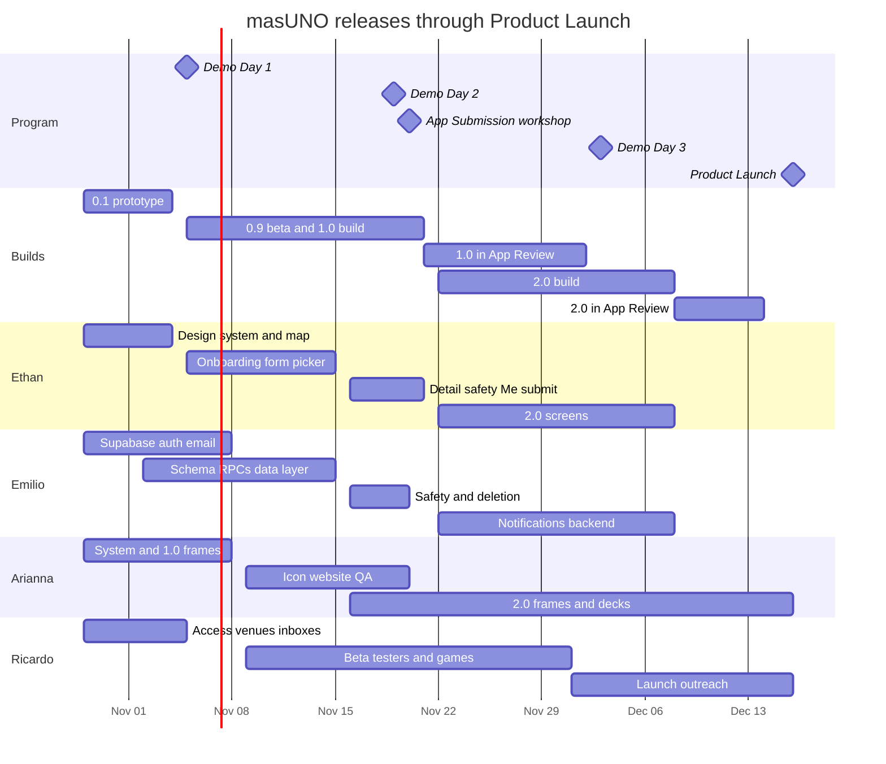

# masUNO iOS — Project Specification

**Rev. 5.3 · 2026-10-30** · replaces `PLAN.md` (rev. 2) and earlier revisions of this spec
**Team:**
- **Ethan Wen** — frontend: the iOS app's screens, view logic and App Store submission.
- **Emilio** — backend: Supabase, plus the Swift data layer that talks to it.
- **Arianna** — design: Figma, app icon, website pages, decks, screenshots, design QA.
- **Ricardo** — team lead and outreach: users, beta testers, hosts, copy, demo days, launch.

**Program:** App Accelerator: Startup to 1000 — Demo Day #1 **Thu Nov 5**, Demo Day #2 **Thu Nov 19**, Demo Day #3 **Thu Dec 3**, Product Launch **Wed Dec 16**
**Status today:** SwiftUI client (~1,900 lines) on mock data; no backend; `com.masuno.app` registered on the Boys & Girls Clubs of Chicago developer team (Oct 28).

> **How to read this.** §0–§6 are the plan: releases, scope, calendar, who does what, how we work. §7–§9 are the product and technical spec. §10–§13 are release steps, risks, decisions and what comes after. Items marked **⚑** change a rev. 2 decision and need Ricardo's sign-off as team lead at kickoff (§12).
>
> **IDs:** **E** = Ethan, **B** = Emilio (backend), **D** = Arianna (design), **O** = Ricardo (outreach).
>
> **Estimates** are focused build hours for one developer working with AI coding tools, including self-testing, excluding program sessions and code review.
>
> **Times:** program sessions are 5:00–6:30 pm Central (6:00–7:30 pm Eastern for Ethan).

---

## 0. Summary

- **Four builds, one per program checkpoint:**
  - **Build 0.1 — Demo Day #1 (Nov 5):** the redesigned app on mock data, on TestFlight.
  - **Build 0.9 — Demo Day #2 (Nov 19):** the real app on Supabase with Tec sign-in, hosting and joining, in an external TestFlight beta.
  - **1.0 — submitted Sat Nov 21:** the core loop plus everything App Review requires. Live on the App Store before Demo Day #3 (Dec 3).
  - **2.0 — after Demo Day #3:** notifications, Saved games, Spanish, Add to Calendar and polish. Submitted Tue Dec 8, live for the Product Launch (Dec 16).
- **Two coders, split at the data layer:**
  - **Ethan** builds everything you can see: screens, navigation, view models, design system, App Store submission.
  - **Emilio** builds everything under the screens: Supabase (tables, rules, functions, jobs, email, notifications) and the Swift code that calls it (sign-in service, repositories, the game store).
  - They meet at one contract (§8.5) and the Swift repository protocols, agreed by Wed Nov 4.
- **Hours:** Ethan ≈ 84 h, Emilio ≈ 69 h. Ethan's 1.0 load is the heaviest on the team (~20 h/week until Nov 20). When Emilio is ahead, he takes the non-visual Swift logic off Ethan's plate (§5.2).
- **Arianna (~5 h/week)** turns the green frames into a finished design system and draws the missing screens ahead of Ethan. She also makes the app icon, website pages, decks and screenshots, and checks each build against Figma.
- **Ricardo (~5 h/week)** gets people:
  - Tec test inboxes, beta testers, hosts and real games.
  - The policy and App Store copy, Spanish translation, demo-day stories and numbers.
  - The launch push and moderation.
- **No domain, no custom email.** Sign-in codes come from a team Gmail; the policy and support pages live on `masuno-app.github.io`; report alerts go to the team chat; both Supabase projects stay on the free plan.

---

## 1. What changed

### This revision (rev. 5)

| # | Change | Why | Sign-off |
| - | --- | --- | --- |
| N6 | **Roles:** Ethan frontend, Emilio backend, Arianna design, Ricardo outreach. All work in §5 re-assigned. | Team decision. | — |
| N7 | **Split at the data layer:** Emilio owns `AuthService`, the repositories and `GameStore` (Swift), not just the database. | Keeps Supabase knowledge in one head and evens out the coders' hours (otherwise Ethan would carry ~105 h). | — |
| N8 | **Supabase access:** Ricardo's organization stays the owner (rev. 2 decision 10), but Emilio is added as an **Owner** of it; or Ricardo transfers the organization to Emilio. | The backend developer needs full control (billing-free plan, secrets, members). | ⚑ |
| N10 | **Repo setup task (E0)** for Ethan, due Nov 1: access, branch protection, folders, config template, `CODEOWNERS`, PR template, README. `CODEOWNERS` moves from B11 to E0. | Emilio can't start B1 until the repo is ready for two coders. | — |
| N9 | **Design leads the build:** Arianna delivers frames for each screen before Ethan builds it (§4.2), and reviews screenshots in UI PRs. | Rev. 4 had no designer; several 1.0 screens have no frame. | — |

### Rev. 4 (still in force)

N1 builds at each demo day, 1.0 before Demo Day #3, 2.0 after it, launch Dec 16 · N2 smaller 1.0, notifications and polish in 2.0 · N3 no domain or custom email (Gmail SMTP, GitHub Pages, team-chat alerts, free Supabase) · N4 one-page Privacy & Terms.

### From rev. 2 (carried over)

| # | Change | Why | Sign-off |
| - | --- | --- | --- |
| C1 | Releases with fixed scope replace the open backlog. | Rev. 2 ≈ 95 dev-days; about 16 are available. | — |
| C2 | **No chat screen** during the program; meet-up spot and Who's going live on Event detail. Chat v1 design kept in Appendix A. Reverses decision 3. | A disabled "Messages are coming soon" composer invites an App Review 2.1 rejection; hub + timeline costs ~8 h. | ⚑ |
| C3 | **"Add to Calendar" button** (EventKitUI, no permission prompt) in 2.0 instead of calendar sync. Reverses decision 14. | 1.5 h instead of ~16 h; edited games don't update the calendar entry. | ⚑ |
| C4 | **No profile photos** during the program; initials avatars. | No storage, upload or image moderation. | ⚑ |
| C5 | **Names show as "First L."** (e.g. "Emilio G.") to others; no name-visibility setting. | Privacy-forward default, no settings screen. | ⚑ |
| C6 | Notifications in **2.0**. | Biggest single item (~19 h) and needs an APNs key (created in the B&GC developer account). | ⚑ |
| C7 | Notification outbox drained by a 1-minute `pg_cron` job. | Batching and retries in one place. | — |
| C8 | `profiles` (public card) split from `profile_private` (own row only). | Fixes rev. 2's RLS: views couldn't read the host's name. | — |
| C9 | `events.going_count` stored, with `check (going_count <= capacity)`. | Correct counts with blocks; overbooking impossible. | — |
| C10 | `events.ends_at` set by trigger. | `timestamptz + interval` can't be a generated column. | — |
| C11 | Location asked when the map first opens; notifications (2.0) after the first join or hosted game. | Better grant rates; shorter onboarding. | — |
| C12 | App Review uses a hidden **demo campus** with auto-refreshed games. | Reviewers always see joinable games; real users never see fake ones. | — |
| C13 | Apple account: B&GC team; all four of us already have access. Still needed for 2.0: an APNs key. | `com.masuno.app` registered Oct 28. | — |
| C14 | Raise Supabase's auth-email limit (30/hour default with custom SMTP). | A demo-day or launch post could exceed 30 sign-ups an hour. | — |
| C15 | Metrics from one SQL view + App Store Connect; no analytics SDK. | Demo-day numbers at ~2 h cost. | — |
| C16 | Minimum-version gate in 1.0. | Lets 2.0 force an update if needed. | — |
| C17 | `supabase/` lives in the `ios` repo. | One PR can change client and database together. | — |

**Still locked from rev. 2:** Supabase; @tec.mx email codes only; sports only (Basketball, Tennis, Soccer, Volleyball); no organizer approval; Tec de Monterrey; English first with strings externalized; venue search + pin + current location; 7-day posting window; light mode only; sign-in gates the app; no skill level; soft cancel; separate dev and prod projects.

---

## 2. Goals & release criteria

**Goals**
1. A build to show at every demo day; 1.0 on the App Store before Demo Day #3; 2.0 on the App Store for the Product Launch.
2. A Tec student can sign up, find or post a game, join it and know where to show up, in under 2 minutes from install.
3. Pass App Review's user-generated-content rules: agree to guidelines, text filter, report, block, act on reports within 24 h, contact info in the app, in-app account deletion.
4. Numbers for each demo day: beta testers, verified sign-ups, games hosted, joins, games that filled.

**Not in scope during the program:** messaging, photos, calendar sync, dark mode, Android/web, organizer approval, recurring games, non-sport activities, other campuses, our own domain or branded email.

**Release criteria for 1.0 and 2.0**
- Core loop works on two physical phones against `masuno-prod`, including two people racing for the last spot.
- App Review checklist (§10.4) all green.
- No crash in the last 3 days of TestFlight (Xcode Organizer).
- Every user-facing string in the String Catalog; VoiceOver can complete the core loop (full accessibility pass in 2.0).
- Arianna has signed off that each screen matches its frame (or the difference is noted).

**Demo-day targets** (testers, sign-ups, games) are set by Ricardo at kickoff and reported before each demo day (O10).

---

## 3. Releases & scope

| Build | Channel | Shown at | Contents |
| --- | --- | --- | --- |
| **0.1 Prototype** | TestFlight (internal; external if Beta App Review clears in time) | Demo Day #1, Thu Nov 5 | Green design system; map + popup redesign; new navigation; game form look. Mock data. |
| **0.9 Beta** | TestFlight external beta (Tec testers) | Demo Day #2, Thu Nov 19 | Live Supabase: real Tec sign-in, map from the database, host/join/leave/cancel, event detail, Me, report/block. |
| **1.0** | App Store, released on approval | Demo Day #3, Thu Dec 3 (live) | Everything in "1.0 scope" below. |
| **2.0 beta** | TestFlight | Demo Day #3 (sneak peek) | Notifications and Saved working end to end. |
| **2.0** | App Store, manual release | Product Launch, Wed Dec 16 | Everything in "2.0 scope" below. |

### 1.0 scope
- Email-code sign-in for @tec.mx; App Review password path; onboarding (6 screens); suspended-account and update-required screens.
- Map: pins with "Soon" label, popup, search, sport filter, recenter, campus fallback when location is off or far away.
- Game form: add/edit with validation; Where's the game? (search + current location); optional meet-up spot; cancel game.
- Event detail: Open / You're in / Full / Hosting / Ended / Cancelled; Who's going; Open in Apple Maps; overflow menu; Leave dialog.
- Join/leave with server-enforced capacity and optimistic UI.
- Me: Going and Hosting lists.
- Safety: report person or game, block/unblock, Blocked people, text filter, report alerts, bans.
- Settings: Location status, Blocked people, Community guidelines, Privacy & Terms, Contact us, version, Sign out, Delete account.
- Basic empty/error/offline states; app icon.

### 2.0 scope
- Notifications: a spot opened (Saved games), game changed, game cancelled, 30-min reminder, new game matching your interests, host updates; Notifications section in Settings; permission asked after the first join or hosted game.
- Saved: bookmark on Event detail, "Notify me if a spot opens" on full games, Saved list from the map.
- Spanish localization (strings, dates, sport names, notification text).
- Add to Calendar; Invite a friend; Google Maps option in Open in Maps.
- Location picker drag-to-adjust; "Happening now" state; "changed since you joined" banner.
- Me: Past games (last 14 days) and Edit profile & interests.
- Full accessibility pass; metrics view; fixes from 1.0 feedback.

### After the program (§13)
Chat v1, profile photos, calendar sync, name-visibility setting, dark mode, links that open a specific game, organizer approval, recurring games, non-sport activities, new campuses, own domain/email.

### Cut order if we slip
- **1.0** — move to 2.0 one at a time, announced at the Wednesday Team Session: (1) sport filter; (2) Hosting tab polish (Edit/Cancel stay reachable from Event detail); (3) search on the map; (4) offline banner (keep retry).
- **2.0** — (1) Google Maps option; (2) drag-to-adjust; (3) "changed since you joined" banner; (4) host-update notifications.
- **Never cut** anything on the App Review checklist.

---

## 4. Timeline

### 4.1 Key dates

| Date | Milestone | Exit check |
| --- | --- | --- |
| **Sat Oct 31** | Access | Emilio is an Owner on the Supabase organization (O2); team Gmail exists (O3). |
| **Sun Nov 1** | Kickoff | §12 decisions signed off; `masuno-dev` exists; API contract draft in `docs/API.md`; Arianna's token table handed to Ethan; repo ready for two coders (E0); everyone has read their Trello cards. |
| **Wed Nov 4** | Contract freeze · Build 0.1 uploaded | Table names, RPC signatures, error codes and Swift protocols merged. 0.1 on TestFlight (internal). |
| **Thu Nov 5** | **Demo Day #1** | Build 0.1 on a real phone: map → popup → game form look. |
| **Sun Nov 8** | Walking skeleton | Real code arrives in a real @tec.mx inbox from the team Gmail; onboarding completes; map reads games from `masuno-dev`. |
| **Sun Nov 15** | Core loop | Phone A hosts, phone B joins, B leaves, A cancels on `masuno-dev`. `masuno-prod` created. Privacy & Terms page live. |
| **Tue Nov 17** | Build 0.9 beta | Submitted to Beta App Review; Ricardo invites Tec testers when it clears. |
| **Thu Nov 19** | **Demo Day #2** | Live demo on prod with real testers' games; first metrics. |
| **Fri Nov 20** | 1.0 release candidate | All 1.0 scope merged; App Submission workshop (5–6 pm CT); listing and screenshots in App Store Connect. |
| **Sat Nov 21** | **Submit 1.0** | Released automatically on approval. |
| Nov 25–27 | Thanksgiving break | No program sessions; light work only. |
| **Mon Nov 30** | 1.0 resubmit cutoff | If rejected, fixes resubmitted by today so 1.0 is live for Demo Day #3. |
| **Tue Dec 1** | 2.0 beta | Notifications working in TestFlight. |
| **Thu Dec 3** | **Demo Day #3** | 1.0 live on the App Store; 2.0 beta shown. |
| **Tue Dec 8** | **Submit 2.0** | Manual release. |
| **Fri Dec 11** | 2.0 resubmit cutoff | — |
| **Mon Dec 14** | Release 2.0 | Or the moment it's approved, if later. |
| **Wed Dec 16** | **Product Launch** | 2.0 live; waitlist email sent; launch deck. |

### 4.2 Week by week

Program weeks shown; the Wednesday Team Session doubles as our weekly sync. Arianna's frames for a screen land the week before Ethan builds it.

| Week | Ethan (frontend) | Emilio (backend) | Arianna (design) | Ricardo (outreach) |
| --- | --- | --- | --- | --- |
| **Now** (Oct 29–Nov 1) | Repo setup (E0); contract + protocols (E1); design system (E2) | Dev project (B1); contract + schema start (B3) | Finalize green system + token table (D1) | Supabase access for Emilio (O2); team Gmail (O3); kickoff (O1) |
| **Wk 7** (Nov 2–8) · DD1 Thu | Nav (E3), map/popup (E4), upload 0.1 (E6); onboarding screens (E5) | Gmail SMTP (B2); auth hook (B4); schema/RPCs (B3); `AuthService` (B5); `GameStore` (B6); iOS CI (B11) | Onboarding + 1.0 missing-screen frames (D2); DD1 deck design (D5) | Venue list (O5); Tec email check + test inboxes (O4); DD1 story + script (O10) |
| **Wk 8** (Nov 9–15) | Game form (E7), location picker (E8), live map (E9) | RPCs done (B3); live repositories (B7); database tests (B10); prod project (B12) | App icon (D3); website Privacy & Terms + support pages (D4); design QA of first live screens (D6) | Policy + support copy (O6); recruit beta testers (O8) |
| **Wk 9** (Nov 16–22) · DD2 Thu, submit Sat | Event detail (E10), safety screens (E11), Me (E12), Settings (E13), states + release hygiene (E14), submit 1.0 (E15) | Safety backend + alerts (B8); delete-account function (B9); fixes | Screenshots (D7); DD2 deck (D5); 2.0 frames (D8) | Listing copy into App Store Connect (O7); beta + real games (O8, O9); DD2 numbers (O10); moderation starts (O11) |
| **Wk 10** (Nov 23–29) · Thanksgiving | 2.0: notification screens (E16), Saved screens (E17) | 2.0: notification backend (B13), `send-push` (B14), Saved backend (B15), device-token code (B16) | Design QA of 1.0 release | Spanish translation (O12); beta feedback summary (O8) |
| **Wk 11** (Nov 30–Dec 6) · DD3 Thu | 2.0: Spanish (E18), calendar/invite/maps (E19), picker drag + banner (E20), Me Past + edit profile (E21), 1.0 fixes; 2.0 beta Tue | 2.0: metrics (B17), Spanish notifications (B18), 1.0 fixes | DD3 deck (D5); Spanish layout check (D9) | DD3 story + numbers (O10) |
| **Wk 12** (Dec 7–13) | Accessibility + tests (E22); submit 2.0 Tue (E23) | Notification tests, prod checks (B19) | 2.0 screenshots (D7); launch deck (D5) | Launch-week games (O9); PR/FAQ final; launch plan (O13) |
| **Wk 13** (Dec 14–16) | Release 2.0 Mon | On call | Product Launch | Waitlist email + launch posts (O13); on call |



---

## 5. Work split

The two coders split at the data layer. Everything below the view models (Supabase and the Swift code that calls it) is Emilio's; everything a user sees is Ethan's. The contract in §8.5 and the Swift repository protocols (E1) are the interface. Ethan and Emilio review each other's PRs; Arianna reviews screenshots in PRs that change a screen.

### 5.1 Ethan — frontend

| ID | Work | Release | Est. | Due | Depends on | Done when |
| --- | --- | --- | --- | --- | --- | --- |
| E0 | **Repo setup** (§6): Emilio Write, Arianna + Ricardo Triage; protect `main` (PR + 1 approval, squash merge); folders `MasUno/{Views, ViewModels, DesignSystem, Data}`, `supabase/`, `docs/` (SPEC, API, QA); `.gitignore` + `Config.xcconfig.template` wired into `project.yml`; check history for committed keys; `project.yml` (bundle ID, B&GC team, iOS 26); `CODEOWNERS`; PR template; README setup steps. | 0.1 | 2 h | Nov 1 | — | Emilio clones, builds on a simulator, and opens a PR that's blocked until Ethan approves. |
| E1 | **Contract + domain models** with Emilio: `Profile`/`PersonSummary` with UUIDs, `Activity`, `Place`, `Game`, `DomainError`; `AuthService`, `GameRepository`, `ProfileRepository` and `SafetyRepository` protocols + mocks. | 0.1 | 3 h | Nov 4 | — | Protocols merged; Emilio builds live versions against them. |
| E2 | **Green design system in code** (§7.1) from Arianna's tokens: button styles, `FieldBox` with error state, chips, `ActivityTile`, initials `Avatar`, `AvatarStack`, `GameCard`, `SettingsRow`, `SheetHeader`; String Catalog. | 0.1 | 6 h | Nov 4 | D1 | No hard-coded colors in views; DEBUG component gallery. |
| E3 | **Navigation shell** (§7.3) + update-required screen. | 0.1 | 2 h | Nov 4 | E1 | All routes reachable. |
| E4 | **Map + popup redesign** on mocks (Figma 341:1979, 341:2046). | 0.1 | 5 h | Nov 4 | E2 | Matches the frames on mock data. |
| E5 | **Onboarding screens** (§7.5), driven by the `AuthService` protocol; suspended screen. | 0.9 | 4 h | Nov 8 | D2, E1 | Works on mock auth; works live once B5 lands. |
| E6 | **Build 0.1** to TestFlight. | 0.1 | 1 h | Nov 4 | E2–E4 | On TestFlight for Demo Day #1. |
| E7 | **Game form** add/edit, validation (Figma 341:3054), error messages, Cancel dialog. | 0.9 | 6 h | Nov 11 | B6 | Create/edit/cancel round-trip on `masuno-dev`. |
| E8 | **Where's the game?**: search + current location. | 0.9 | 3 h | Nov 12 | E7 | Spot set by search or by location. |
| E9 | **Live map**: location prompt, campus fallback + banner, search, sport filter, "Soon" labels, pull to refresh. | 0.9 | 4 h | Nov 14 | E4, B7 | Map shows real games from the database. |
| E10 | **Event detail** (§7.6.4): 1.0 states, Who's going row, overflow menu, Leave dialog, Open in Apple Maps. | 0.9 | 7 h | Nov 17 | E9, D2 | Each state reachable with DEBUG launch arguments; last-spot race shows the right message. |
| E11 | **Safety screens** (§7.6.6): Who's going sheet with flag menu, report sheet, block confirmation, Blocked people. | 1.0 | 5 h | Nov 18 | B8, D2 | Blocked person's games and name vanish without refreshing. |
| E12 | **Me**: Going and Hosting lists with Leave/Edit. | 1.0 | 4 h | Nov 18 | E10 | Matches Figma 341:2165/341:2240 minus chat buttons. |
| E13 | **Settings** (1.0 rows) + Delete account flow. | 1.0 | 2.5 h | Nov 19 | B9 | Delete account signs you out and the account is gone. |
| E14 | **States + release hygiene**: empty/error/offline basics, app icon, launch screen, remove demo scaffolding, Release → prod. | 1.0 | 3 h | Nov 19 | D3 | Release build has no DEBUG menus; airplane mode never strands a screen. |
| E15 | **Submit 1.0**: builds, privacy label, age rating, review notes; Ricardo enters the listing (O7). | 1.0 | 2 h | Nov 21 | O7, D7 | 1.0 submitted. |
| | *1.0 subtotal* | | *59.5 h* | | | |
| E16 | **Notification screens**: permission primer after first join/host, tap → game, Notifications section in Settings. | 2.0 | 3.5 h | Nov 29 | D8, B16 | Tapping each notification type opens the right game. |
| E17 | **Saved screens**: bookmark, "Notify me if a spot opens", Saved list from the map. | 2.0 | 2.5 h | Nov 29 | D8, B15 | Saved survives relaunch. |
| E18 | **Spanish**: String Catalog `es`, locale-aware dates, `label_es` for sports. | 2.0 | 2 h | Dec 4 | O12 | Whole app readable with the phone set to Spanish. |
| E19 | **Add to Calendar**, **Invite a friend**, Google Maps option. | 2.0 | 2.5 h | Dec 4 | — | Calendar editor opens prefilled, with no permission prompt. |
| E20 | **Picker drag-to-adjust** + address lookup; "Happening now" state; "changed since you joined" banner. | 2.0 | 3.5 h | Dec 5 | D8 | Drag sets a spot; banner shows after a host edit. |
| E21 | **Me: Past games + Edit profile & interests** (reuses onboarding screens 4–5). | 2.0 | 3 h | Dec 5 | — | Changed interests save and reload. |
| E22 | **Accessibility + UI tests**: Dynamic Type, VoiceOver labels, 44 pt targets; one UI smoke test. | 2.0 | 4 h | Dec 7 | — | Core loop with VoiceOver at XXL text. |
| E23 | **1.0 fixes + 2.0 submission.** | 2.0 | 3 h | Dec 8 | — | 2.0 submitted. |
| | **Ethan total** | | **1.0 59.5 h · 2.0 24 h · 83.5 h** | | | |

### 5.2 Emilio — backend (Supabase + Swift data layer)

| ID | Work | Release | Est. | Due | Depends on | Done when |
| --- | --- | --- | --- | --- | --- | --- |
| B1 | **Supabase dev setup**: `masuno-dev`, CLI, `supabase/` folder, seed script (Tec, 4 sports, Ricardo's venues, test users, games), `Config.xcconfig` template. | 0.9 | 3 h | Nov 3 | E0, O2, O5 | `supabase db reset` works locally for Ethan too. |
| B2 | **Sign-in email via team Gmail** (§8.4): SMTP with app password, code-only template, 10-min expiry, raised rate limit, tested on Tec inboxes. | 0.9 | 1.5 h | Nov 6 | O3, O4 | Codes reach Tec inboxes (not junk) within a minute. |
| B3 | **Schema, RLS, RPCs** (§8.3–§8.5) incl. report/block, text filter, App Review demo campus; `docs/API.md` by Nov 4. | 0.9 | 13 h | Nov 11 | E1 | Every 1.0 RPC works from the SQL editor as a test user. |
| B4 | **Auth hook** (deny by default), `auth_allowlist`, 2 review accounts with passwords, `sign_in_method(email)`. | 0.9 | 2 h | Nov 6 | B1 | Non-Tec email gets the friendly error; review account signs in with a password. |
| B5 | **`AuthService` (Swift)**: send/verify code, password path, session persistence, expired-session and suspended detection. | 0.9 | 4 h | Nov 8 | E1, B4 | Ethan's onboarding screens sign in for real. |
| B6 | **`GameStore` (Swift)**: `@Observable`, `LoadState`, optimistic join/leave + rollback, error-code → `DomainError`; remove `SkillLevel`, `Venue`, `Person.you` from the model layer. | 0.9 | 5 h | Nov 10 | E1 | Store unit tests green on mock repositories. |
| B7 | **Live repositories** (`supabase-swift` v2) for games, profiles, safety. | 0.9 | 6 h | Nov 13 | B3, B6 | Mock ↔ live is a one-line switch. |
| B8 | **Safety backend**: report alert webhook to team chat, bans, instant local hiding of blocked people in `GameStore`. | 1.0 | 3 h | Nov 17 | B3 | Report alert arrives within a minute; blocked person disappears before the server answers. |
| B9 | **`delete-account` Edge Function** + repository call. | 1.0 | 2 h | Nov 17 | B3 | Deleting cancels hosted games and frees joined spots. |
| B10 | **Database tests** (pgTAP): last-spot race, RLS visibility, blocks, bans, posting window; run on PRs touching `supabase/`. | 0.9 | 2 h | Nov 15 | B3 | A deliberately broken policy fails CI. |
| B11 | **CI** (GitHub Actions): iOS generate → build → unit tests on PRs to `main`, plus the database tests. (`CODEOWNERS` and branch protection are in E0.) | 0.9 | 1.5 h | Nov 8 | E0 | Ethan adds it as a required check on `main`. |
| B12 | **Prod project**: latency test (Ricardo runs it from a phone in Monterrey), create `masuno-prod`, migrations, demo campus check, keep-alive + weekly backup (§8.1). | 0.9 | 1.5 h | Nov 15 | B3 | TestFlight builds run on prod. |
| | *1.0 subtotal* | | *44.5 h* | | | |
| B13 | **Notification backend**: device tokens, preferences, outbox written by RPCs, 1-min drain job, 5-min reminder job, interest matches (max 2/day), changed/cancelled, host updates. | 2.0 | 8 h | Nov 28 | — | Each row of §8.7 produced by the right trigger. |
| B14 | **`send-push` Edge Function** (APNs token auth, collapse per game, invalid-token cleanup). | 2.0 | 4 h | Nov 29 | APNs key | Test push reaches a TestFlight build from prod. |
| B15 | **Saved backend**: `bookmarks`, `toggle_bookmark`, spot-opened fan-out, repository calls. | 2.0 | 1 h | Nov 28 | B13 | Leaving a full game queues a notification for everyone who saved it. |
| B16 | **`NotificationService` (Swift)**: token registration, preferences repository. | 2.0 | 1.5 h | Nov 28 | B13 | Token appears in `device_tokens` after permission. |
| B17 | **Metrics view** + moderation SQL snippets (ban, cancel game, clear name). | 2.0 | 2 h | Dec 2 | — | "How many sign-ups yesterday?" is one query. |
| B18 | **Spanish on the server**: each user's language stored; notification text in their language. | 2.0 | 1.5 h | Dec 4 | O12 | Spanish phones get Spanish notifications. |
| B19 | **Notification tests + 1.0 fixes + prod checks.** | 2.0 | 6 h | Dec 8 | — | Triggers covered by pgTAP; prod migrations applied before 2.0 release. |
| | **Emilio total** | | **1.0 44.5 h · 2.0 24 h · 68.5 h** | | | |

**Balancing rule:** Ethan's 1.0 load (~20 h/week) is higher than Emilio's (~15 h/week). If Emilio is ahead at a Wednesday sync, he takes non-visual Swift work from Ethan's lane in this order: form validation logic (E7), event-state derivation for Event detail (E10), unit tests for both. If Ethan is still behind after that, apply the cut order (§3).

### 5.3 Arianna — design

| ID | Task | For | ~Hours | Due |
| --- | --- | --- | --- | --- |
| D1 | **Finalize the green system in Figma**: confirm tokens (§7.1) as Figma variables; component set; fix known issues (unify copy per §7.2, green checkmarks, remove mic glyph, "· Read", meet-up photo, chat entry points, non-sport placeholder content). Hand Ethan the token table. | 0.1 | 3 | Nov 1 |
| D2 | **Frames for 1.0 screens that have none**: onboarding (6 screens) first, then Event detail states (Full, Hosting, Ended, Cancelled), report sheet, block dialog, Blocked people, Settings (1.0 rows), empty/error/offline. | 0.9 | 6 | Onboarding Nov 4; rest Nov 10 |
| D3 | **App icon** (1024 × 1024, no transparency) + launch-screen color. | 1.0 | 2 | Nov 12 |
| D4 | **Website pages** on `masuno-app.github.io`: Privacy & Terms and Support, using Ricardo's copy (O6). | 1.0 | 3 | Nov 13 |
| D5 | **Deck design** for Demo Days #1–#3 and the Product Launch (Ricardo writes the story). | DD1–Launch | 6 | Nov 5, Nov 19, Dec 3, Dec 16 |
| D6 | **Design QA** of each build against Figma; Trello bugs with screenshots; review screenshots in UI PRs. | All | 1.5 per build | Nov 12 onward |
| D7 | **App Store screenshots** (6.9") from the release candidate with short captions; redo for 2.0. | 1.0 / 2.0 | 3 | Nov 20 / Dec 8 |
| D8 | **2.0 frames**: notification primer, Notifications settings, Saved list, "Notify me" state, "Happening now", "changed since you joined" banner, location picker drag. | 2.0 | 3 | Nov 22 |
| D9 | **Spanish layout check**: long strings, truncation, buttons. | 2.0 | 1 | Dec 4 |
| D10 | *Optional:* small SwiftUI PRs (spacing/color tweaks found in design QA), reviewed by Ethan. | — | — | Any time |

### 5.4 Ricardo — team lead & outreach

| ID | Task | For | ~Hours | Due |
| --- | --- | --- | --- | --- |
| O1 | **Kickoff as team lead**: sign off §12 decisions; set demo-day targets; pick the report-alert chat. | All | 1 | Nov 1 |
| O2 | **Supabase access**: add Emilio as Owner of the organization (or transfer it). | 0.9 | 0.5 | Oct 31 |
| O3 | **Team Gmail** (e.g. `masunoapp@gmail.com`) with 2-step verification; shared password manager for it, the review-account passwords and later the APNs key. | 0.9 | 0.5 | Oct 31 |
| O4 | **Tec email check**: student address format (`A0…@tec.mx`?) and whether staff share `@tec.mx`; 3–5 Tec inboxes Emilio can test with. | 0.9 | 1 | Nov 4 |
| O5 | **Venue list**: 10–15 real places near Tec for pickup sports (name, address, coordinates, sports) for seed data and the demo campus. Run the Supabase latency test from a phone in Monterrey when Emilio sends the links. | 0.9 | 2 | Nov 3 |
| O6 | **Policy + support copy** from the outline in §10.2; Emilio checks every data claim. | 1.0 | 2 | Nov 10 |
| O7 | **App Store listing**: name, subtitle, description, keywords, promo text, support/privacy URLs; enters them in App Store Connect. Describes only what that version does — no chat. | 1.0 / 2.0 | 2 | Nov 18 / Dec 7 |
| O8 | **Beta**: recruit 15–30 Tec students from the waitlist; manage the external TestFlight group; short feedback Google Form; weekly summary at the Team Session. | 0.9 | 5 | Nov 13 – Dec 1 |
| O9 | **Hosts & real games**: 2–3 real games during beta week and launch week; film a short clip for the decks. | DD2–Launch | 4 | Nov 19, Dec 16 |
| O10 | **Demo-day stories, scripts and numbers** (testers, sign-ups, games, joins from App Store Connect and the metrics view). | DD1–Launch | 6 | Nov 5, Nov 19, Dec 3, Dec 16 |
| O11 | **Moderation rota** with Arianna: check report alerts daily from the beta onward, act within 24 h (§10.6). | 0.9 onward | 10 min/day | From Nov 17 |
| O12 | **Spanish translation** of the String Catalog export (natural Mexican Spanish; a second native speaker reviews). | 2.0 | 3 | Nov 29 |
| O13 | **Launch**: waitlist email, social posts, the program's marketing/funnel/business-model deliverables, and a February campus-launch plan (clubs, recurring hosts). | Launch | 5 | Dec 16 |

---

## 6. How we work

- **Repo:** `masUNO-app/ios` — `MasUno/` (app), `supabase/` (migrations, functions, tests, seed), `docs/` (this spec, `API.md`, `QA.md`).
- **Code ownership:** `MasUno/Views`, view models, design system → Ethan. `MasUno/Data` (AuthService, repositories, GameStore, NotificationService) and `supabase/` → Emilio. A `CODEOWNERS` file (E0) makes GitHub request the right reviewer.
- **Branches:** `main` protected; short-lived branches; one approving review from the other coder; squash merge; review within 24 h.
- **Contract first:** `docs/API.md` and the Swift protocols are the boundary; a change to either is one PR reviewed by both coders.
- **Migrations:** never edit an applied migration; only Emilio pushes to prod, only from `main`, before the matching TestFlight build.
- **Environments:** Debug → `masuno-dev`; TestFlight and App Store → `masuno-prod` from build 0.9 (beta games are real games).
- **Design hand-off:** a screen is ready to build when its frame is marked "Ready" in Figma. If it isn't ready, Ethan builds from §7 and Arianna adjusts in design QA.
- **Done means:** check in §5 met · strings in the catalog · run on a real phone · reviewed · CI green · (screens) screenshot approved by Arianna.
- **Cadence:** Wednesday Team Session = weekly sync (demo on a phone, hours vs §5, cut decisions, beta feedback from Ricardo). **Trello** (board "2026 UnaMas"): backlog lists by release ("MVP · 1.0 — submit Sat Nov 21", "2.0 · Product Launch — submit Tue Dec 8", "Post MVP Features (after Dec 16)"); at each Wednesday sync, the next week's cards move into **Current Sprint** → **In Progress** → **Done**. Every card title starts with its owner's name and carries the owner's role label (Frontend = Ethan, Backend = Emilio, Design = Arianna, Marketing = Ricardo), plus a due date from §5. Each person also clicks **Join** on their own cards, since the Trello connector can't assign members.
- **Secrets:** team Gmail, review-account passwords and the APNs key live in the shared password manager — never in the repo or a chat.

---

## 7. Product specification

### 7.1 Design system — green theme (D1 → E2)

Sampled from the green frames; Arianna confirms them as Figma variables in D1. Replaces `Theme.swift`'s orange/cream palette.

| Token | Hex | Use |
| --- | --- | --- |
| `accent` | `#12815A` | Primary buttons, toggles, check badges. White label, 4.9:1. |
| `accentSoft` | `#DDF1E8` | Secondary buttons, status chips, initials avatars, segmented track. |
| `background` | `#F5F4F7` | Screens and sheets. |
| `card` | `#FDFCFE` | Cards, grouped rows, popups. |
| `ink` | `#1F2638` | Titles and body. |
| `muted` | `#5F5C68` / `#73707B` | Secondary text; `#73707B` only for ≥ 18 pt or ≥ 14 pt bold. |
| `pin` | `#2F6FE0` | Map pins only. |
| `destructive` | `#C23B34` | Cancel game, Sign out, Delete account. |
| `error` | `#CB3D3D` | Field errors. |
| `chipSport` | `#DCE4F4` | Interest chips. |

Cards 16–20 pt radius with hairline border; pill buttons ~50 pt; boxed fields with caption labels; Liquid Glass on floating controls. SF Pro, sentence case, light mode only.

### 7.2 Copy & voice

| Concept | Use | Instead of |
| --- | --- | --- |
| Thing you host/join | **game** — Add game, Edit game, Join game, Cancel game | event |
| Sport field | **Sport** | Activity |
| Capacity | **Players** — "6 players" (helper "Including you"); edit "6 players · 3 going" | Spots |
| Status | "3 going · 3 spots left", "1 spot left", "Full" | "2/3 \| 1 Spot left" |
| Names | "Emilio G." for others; full name only on your own Me card | full names |
| Cancel dialog | "Cancel After-work hoops?" / "We'll let the 3 people who are going know." / "This can't be undone." / **Cancel game** / **Keep game** | Delete event |
| Leave | **Leave** → **Leave game** | Give up your spot |
| Bottom bar | **+ Add game** | + Add event |
| Before you go (1.0) | "Alex can see you joined. Check where to meet and who's going." | group-chat copy |
| Before you go (2.0) | …+ "We'll remind you 30 min before." | — |
| Validation | Hint "Give it a real name, not just the sport"; "Add a name so people know what they're joining."; "9:00 AM has already passed today. Pick a later time." | — |

### 7.3 Navigation

```
Launch → version check → session?
├─ None → Onboarding (§7.5)
├─ Suspended → "Your account is suspended" + support email
└─ Signed in → Map
     ├─ Search · [2.0] Saved → Event detail
     ├─ Pin → Popup → Details / Join game → Event detail
     ├─ Filter · Recenter · + Add game → Game form → Where's the game?
     └─ Avatar → Me
          ├─ Gear → Settings → Blocked people · Privacy & Terms · Delete account
          ├─ Going → Event detail · Leave
          └─ Hosting → Edit → Game form → Cancel
Event detail → Who's going (report/block) · Report game · Open in Maps · [2.0] Calendar · Invite
[2.0] Notification tap → Event detail
```

### 7.4 Figma frames → releases

Frames: `https://www.figma.com/design/5eKA3f0I90VVABrAuNMFD2/masuno-figma?node-id=<id with - for :>` (green set only).

| Frame (node) | Treatment | Release · build / design |
| --- | --- | --- |
| Map (341:1979), Popup (341:2046) | As designed; bookmark button in 2.0; no mic glyph | 0.1 visuals, 0.9 live · E4/E9 · D1 |
| Add event (341:1849), Error (341:3054) | As designed + Meet-up spot field | 0.9 · E7 · D1 |
| Choose location (341:2646) | Search + current location in 1.0; drag in 2.0 | 0.9 / 2.0 · E8/E20 · D8 |
| Event detail (341:2586) | As designed + `…` menu; other states drawn in D2 | 0.9 · E10 · D2 |
| You're in (341:2989) | "Open group chat" removed; 2.0 adds Add to calendar + Invite a friend | 0.9 / 2.0 · E10/E19 · D8 |
| Who's going (341:2309) | Flag → Report / Block | 1.0 · E11 · D2 |
| Me Going/Hosting (341:2165/2240) | No "Group chat · N new"; initials | 1.0 · E12 · D1 |
| Edit / Delete event (341:2703/2840) | "Cancel game" copy | 0.9 · E7 · D1 |
| Settings (341:2144) | 1.0 rows only; notification toggles in 2.0; no calendar or name-visibility rows | 1.0 · E13 · D2/D8 |
| Group chat, Chat rules, Edit meet-up | Not shipped (C2); chat rules text reused in onboarding | — |

### 7.5 Onboarding & sign-in (E5 screens · B5 `AuthService` · D2 frames)

1. **Welcome** — "Find your next game" / "Pickup games around Tec, one or two players short — and looking for you." **Continue with your Tec email**. Footer link: Privacy & Terms.
2. **Email** — "What's your Tec email?" Must end exactly in `@tec.mx`, else "masUNO is just for Tec students right now. Use your @tec.mx email." Calls `sign_in_method(email)`: code, or (review accounts only) password.
3. **Code** — "Check your email" / "We sent a 6-digit code to a0…@tec.mx. It comes from masunoapp@gmail.com — check Junk if you don't see it." Six boxes with one-time-code autofill; resend after 30 s; wrong / expired / too-many-tries messages.
4. **About you** — first name, last name, class year; preview "Emilio G. · Class of 2029" with "This is how others see you."
5. **Interests** — "What do you play?" Four sports, at least one.
6. **Community guidelines** — four rules + "You can report or block anyone from the Who's going list." **I agree** (required).

Location is requested when the map first opens; if denied, the map centers on campus with a banner linking to iOS Settings. Notification permission (2.0) comes after your first join or hosted game.

### 7.6 Feature specs

#### 7.6.1 Map (E4, E9)
- Default view: Tec campus center (≈ 25.6514, −100.2895); jumps to you only if you're within ~15 km. Recenter button.
- Shows games that aren't cancelled, ended or full, start within 7 days, and whose host isn't blocked either way.
- Pins: blue with sport emoji; "Soon" if starting within 60 min (2.0 adds "Now"). Selected pin grows with a halo; others dim.
- Popup: host initials, title, "Basketball · Hosted by Alex G.", spots left, time, address, attendee avatars; **Details** + **Join game** / **View game** / **Edit game**.
- Search (title, sport, place, host first name) and sport filter. Standard Apple map style.

#### 7.6.2 Game form (E7)
- Sport, Game name (1–40), Date (today to +6 days), Start time, Duration (30 min–3 h), Location (→ picker), Meet-up spot (optional, ≤ 80), Players (2–22; editing can't go below the number going), Notes (optional, ≤ 280).
- Errors shown in the form and enforced by the server; start must be in the future and within 7 days; max 3 upcoming hosted games per person.
- Edit: "Changes are shared with everyone going." Time/place/meet-up edits record a change time (2.0 uses it for the banner and notification).

#### 7.6.3 Where's the game? (E8, E20)
1.0: search suggestions near campus and "Use my current location" → **Set location** saves name, address and coordinates. 2.0: drag the map under a fixed pin; the address updates as you go.

#### 7.6.4 Event detail (E10)

| State | Chip | Bottom bar |
| --- | --- | --- |
| Open | Open · N spots left | **Join game** |
| You're in | ✓ You're in · N going · N spots left | 1.0: none (Before you go text). 2.0: **Add to calendar** · **Invite a friend** |
| Full | Full | 1.0: "Spots open up when someone leaves — check back." 2.0: **Notify me if a spot opens** |
| Hosting | You're hosting · N going | **Edit game**; prompt to add a meet-up spot if empty |
| Ended | This game has ended | none |
| Cancelled | Alex cancelled this game | none |

- Body: map header, title, sport and host, date/time ("Starts in 35 min · about 1 hour"), address, meet-up spot, **Open in Maps**, notes, Who's going.
- Menu: going → Leave game, Report game; not going → Report game; hosting → Cancel game.
- Join shows "You're in" immediately and rolls back if the server says the game filled: "Someone just took the last spot." If someone you blocked is going: "Someone you blocked is going."

#### 7.6.5 Me (E12, E21)
Card: initials, your full name, "Class of 2029 · Tec de Monterrey", "Verified student" badge (if O4 confirms staff don't share `@tec.mx`; otherwise "Tec verified"), interests. Going and Hosting lists; empty states "No games yet. Find one on the map." / "Host a game in under a minute." 2.0 adds Past (14 days) and Edit profile & interests.

#### 7.6.6 Safety (E11 screens · B3/B8 backend)
- **Who's going:** names, Host badge, "(you)", flag → Report / Block. "Only the masUNO team sees reports."
- **Report** (person or game): Harassment or hate · Inappropriate content · Spam or fake · Made me feel unsafe · Something else (+ note). Then "Thanks — we'll review this within 24 hours." and **Block** for people.
- **Block:** "You won't see each other's games or names, and neither of you can join the other's games." Hidden immediately on the phone, then on the server. Undo in Settings › Blocked people.
- **Text filter:** English + Spanish word list on titles, notes, meet-up spots and names. Message: "Please keep it friendly — try different wording."
- **Bans:** moderators set them in the dashboard; the app then shows the suspended screen.

#### 7.6.7 Settings (E13; Notifications E16)
- *[2.0]* Notifications: Games that match your interests · A spot opens up · Game reminders · Updates on games you host.
- Privacy & safety: Location (opens iOS Settings) · Blocked people · Community guidelines.
- About: Privacy & Terms (website) · Contact us (team Gmail) · Version.
- Account: Sign out · **Delete account** ("We'll cancel games you're hosting, remove you from games you joined, and delete your profile. This can't be undone.").

#### 7.6.8 Empty, error, offline (E14)
Map with no games: "No open games right now. Start one?" Failed loads show a retry card; failed actions show a short message and undo the optimistic change; offline shows "You're offline — showing the last games we loaded."

---

## 8. Technical specification

### 8.1 Architecture & environments
- **Client:** SwiftUI, `@Observable`, iOS 26 target (Liquid Glass — confirm in `project.yml`), XcodeGen, `supabase-swift` v2 behind repository protocols; mocks for previews and tests.
- **Layers:** Views + view models (Ethan) → `GameStore` + `AuthService` + repositories (Emilio) → Supabase (Emilio). Views never import the Supabase SDK.
- **Backend:** Supabase Postgres with RLS on every table; Auth (email codes + allowlisted passwords); Edge Functions for `delete-account` and (2.0) `send-push`; `pg_cron` + `pg_net` for jobs.
- **Projects:** `masuno-dev` and `masuno-prod` in Ricardo's organization, with Emilio as an Owner; both on the **free plan** (2 active projects allowed). Free projects pause after a week without activity and have no automatic backups, so a daily GitHub Action pings prod and Emilio runs `supabase db dump` weekly into private storage (it contains personal data).
- **Region:** no Mexico region. Before creating prod, compare round-trip times from a phone in Monterrey (Ricardo) to throwaway projects in `us-east-1`, `us-east-2` and `us-west-1`; pick the fastest. It can't be moved later.
- **Secrets:** anon key in a git-ignored `Config.xcconfig` per configuration (template checked in); service-role key, Gmail app password and APNs key only in Supabase secrets.

### 8.2 Client modules
- **Ethan:** design system (E2) · navigation + version gate (E3) · `LocationService` (E9) · `CalendarAdder` (E19, 2.0) · all views and view models.
- **Emilio:** `AuthService` (B5) · `GameStore` (B6) · live repositories (B7) · `NotificationService` (B16, 2.0).
- **Shared:** protocols, domain models and mocks (E1); `ActivityCatalog` (cached, with a built-in fallback of the 4 sports).

### 8.3 Schema

```sql
universities (id uuid pk, name text, email_domain text unique,       -- 'tec.mx' (exact match)
  student_email_pattern text null,                                    -- set if O4 finds staff share the domain
  center_lat float8, center_lng float8, timezone text,                -- 'America/Monterrey'
  signup_enabled bool default true, is_demo bool default false)       -- hidden App Review campus (C12)

activities (slug text pk, kind text, label_en text, label_es text, emoji text, sort_order int,
  postable bool default false, interest_selectable bool default false, active bool default true)

profiles (id uuid pk references auth.users on delete cascade,        -- public card (C8)
  university_id uuid references universities, first_name text, last_initial char(1),
  grad_year int, created_at timestamptz default now())

profile_private (user_id uuid pk references profiles on delete cascade,   -- own row only
  last_name text, locale text default 'en', guidelines_accepted_at timestamptz,
  banned_at timestamptz null)                                         -- service role only

profile_interests (user_id uuid references profiles on delete cascade,
  activity_slug text references activities, primary key (user_id, activity_slug))

events (id uuid pk default gen_random_uuid(), university_id uuid, host_id uuid references profiles,
  activity_slug text references activities,
  title text check (char_length(title) between 1 and 40),
  starts_at timestamptz, duration_minutes int check (duration_minutes in (30,60,90,120,180)),
  ends_at timestamptz not null,                                       -- trigger (C10)
  capacity int check (capacity between 2 and 22),                     -- includes host
  going_count int not null default 1, check (going_count between 1 and capacity),  -- C9
  notes text check (char_length(notes) <= 280),
  place_name text, place_address text, lat float8, lng float8,
  meet_point text null check (char_length(meet_point) <= 80),
  material_change_at timestamptz null, cancelled_at timestamptz null,
  created_at timestamptz default now(), updated_at timestamptz)

rsvps (event_id uuid references events on delete cascade, user_id uuid references profiles on delete cascade,
  role text check (role in ('host','player')), joined_at timestamptz default now(),
  primary key (event_id, user_id))

blocks  (blocker_id uuid, blocked_id uuid, created_at timestamptz default now(),
  primary key (blocker_id, blocked_id))                               -- + index (blocked_id, blocker_id)
reports (id uuid pk, reporter_id uuid null references profiles on delete set null,
  target_user_id uuid null, target_event_id uuid null, reason text, note text null,
  status text default 'open', created_at timestamptz default now(), resolved_at timestamptz null)
app_config (key text pk, value jsonb)                                 -- min_supported_version, support_email, privacy_url
auth_allowlist (email text pk, note text)                             -- App Review accounts

-- 2.0 (B13, B15):
bookmarks (event_id, user_id, created_at, primary key (event_id, user_id))
notification_prefs (user_id pk, interest_match bool default true, spot_open bool default true,
  reminders bool default true, hosting bool default true)
device_tokens (token text pk, user_id uuid, environment text, updated_at timestamptz)
notification_outbox (id bigserial pk, user_id uuid, kind text, event_id uuid, payload jsonb,
  created_at timestamptz default now(), locked_at timestamptz, sent_at timestamptz,
  attempts int default 0, error text)
```

**Read views (RLS applies):** `game_cards` (event + host first name/initial + `going_count`, `spots_left`, `my_role`, `my_joined_at`, `has_blocked_attendee`; 2.0 `is_bookmarked`), `game_attendees(event_id)` (excludes blocked people), `my_profile`.

### 8.4 Security, sign-in & email
- **Policies:** `profiles` readable within your university except blocked pairs; `profile_private` own row only; `events`/`rsvps` readable within your university unless the host is a blocked pair; all writes through RPCs; `reports` insert-only via RPC; `universities`, `activities`, `app_config` read-only; `auth_allowlist` no client access. Helpers `is_active(uid)` and `is_blocked_pair(a, b)`.
- **Auth hook (before user created):** allow only an active `universities.email_domain` with sign-up enabled (and `student_email_pattern` if set), or an `auth_allowlist` address. Otherwise "masUNO is just for Tec students right now." Deny by default — Supabase's sample allows unknown domains.
- **Email without a domain:** Supabase custom SMTP → `smtp.gmail.com:587` with the team Gmail and an app password (needs 2-step verification). Sender name "masUNO". Template: the 6-digit code in plain text, no links. Personal Gmail allows about **500 messages a day** — fine for the program; if we approach that, move to a domain + email provider (§13).
- **Rate limits:** raise auth emails/hour from the custom-SMTP default of 30 to ~100 (well under Gmail's daily cap); keep 60 s between codes per user.
- **App Review accounts:** two Gmail aliases (e.g. `masunoapp+review1@gmail.com`) in `auth_allowlist` with passwords, attached to the demo campus.

### 8.5 API contract (frozen Wed Nov 4)

RPCs are `security definer`, pin `search_path`, check `auth.uid()` and `is_active()`, and raise a short code that `GameStore` maps to `DomainError`. Every write returns the updated `game_cards` row.

| RPC | Purpose | Errors |
| --- | --- | --- |
| `sign_in_method(email) → text` | `'otp'` or `'password'` (anonymous; reads the allowlist only) | — |
| `complete_profile(first, last, grad_year, interests[], locale)` | Create/update profile | `invalid_text`, `invalid_input` |
| `accept_guidelines()` | Record agreement | — |
| `create_game(…) → uuid` | Validate sport, 7-day window, limit, text; insert game + host | `invalid_time`, `invalid_text`, `limit_reached`, `invalid_input` |
| `update_game(id, …)` | Host only; players ≥ going; record material changes | `not_allowed`, `cancelled`, `ended`, `capacity_below_going`, `invalid_time`, `invalid_text` |
| `cancel_game(id)` | Host only; soft cancel | `not_allowed`, `ended` |
| `join_game(id)` | Lock row; reject cancelled/ended/host/blocked; `full` if no spots; idempotent | `full`, `cancelled`, `ended`, `blocked`, `not_found` |
| `leave_game(id)` | Lock row; remove; decrement | `not_allowed` (host), `ended` |
| `report(user?, game?, reason, note?)` | Insert report → alert | `invalid_input` |
| `block(user_id)` / `unblock(user_id)` | Own blocks | `invalid_input` |
| *2.0:* `register_device`, `toggle_bookmark`, `set_notification_prefs` | | — |

### 8.6 Jobs & functions (Emilio)
- `delete-account` (B9): cancels upcoming hosted games, leaves joined games under lock, keeps reports with the reporter removed, deletes the auth user.
- **Report alerts** (B8): a database webhook on `reports` posts a short message (reason, target, dashboard link — no personal details) to the team's Discord or Slack via an incoming webhook.
- **Demo campus refresh** (B3): a daily `pg_cron` job keeps 4–6 upcoming games on the hidden campus.
- *2.0:* `send-push` (B14), drained every minute by `pg_cron`: claims up to 100 rows, respects preferences and blocks, APNs token auth, one collapse ID per game, 3 retries, drops dead tokens. Start with a 1-hour test: one push from the Edge Function to a TestFlight build. A reminder job runs every 5 min for games starting in 25–35 min.

### 8.7 Notifications (2.0)

| Notification | To | When | Setting |
| --- | --- | --- | --- |
| A spot opened in [game] | People who saved it | A full game frees a spot | A spot opens up |
| [game] starts in 30 min | Everyone going | Reminder job | Game reminders |
| New [sport] game near you | Interested users (max 2/day) | Game created | Games that match your interests |
| [game] changed | Everyone going | Time/place/meet-up edit | Always on |
| [game] was cancelled | Everyone going | Host cancels | Always on |
| Ricardo G. joined · 2 spots left | Host | Join/leave | Updates on games you host |

### 8.8 Privacy & data
Your phone's location never leaves the phone. Email stays in Supabase Auth and is never shown to anyone. Others see first name, last initial and class year; interests are private. Reports are kept for moderation; deleted accounts are removed right away (reports stay, without the reporter). No analytics SDK; crashes come from Xcode Organizer.

### 8.9 Metrics (B17; counted by hand for DD2)
`metrics_daily` (dashboard only): sign-ups, finished onboarding, games created, joins, unique joiners, games that filled, repeat hosts, reports. Plus App Store Connect for TestFlight testers and downloads. Ricardo turns these into demo-day numbers (O10).

---

## 9. Testing

| Layer | What | Owner |
| --- | --- | --- |
| Database | Last-spot race (two sessions), `going_count` never above players, RLS visible/invisible, blocks both ways, bans, posting window, text filter, auth hook | Emilio |
| Data layer | `GameStore` join/leave + rollback, error mapping, `AuthService` states | Emilio |
| Screens | Form validation, event-state logic, one UI smoke test | Ethan |
| Design QA | Each build vs Figma; screenshots in UI PRs | Arianna |
| Manual | `docs/QA.md` two-phone script: core loop, block/report, delete account, offline, location denied, far away, big text, small phone — run by Arianna and Ricardo on each build | Arianna, Ricardo |
| Beta | 15–30 Tec students from Nov 19; feedback form; weekly summary | Ricardo |

---

## 10. Release plan

### 10.1 Accounts & access
- Developer team: Boys & Girls Clubs of Chicago; App ID `com.masuno.app`. All four of us already have access, so everyone can be an internal TestFlight tester from build 0.1, and Ricardo can enter the listing and manage external testers.
- **APNs key for 2.0 (by Nov 22, before B14):** created by whoever has the Admin role, or App Manager with access to Certificates, Identifiers & Profiles. The `.p8` file goes straight into the password manager and Supabase secrets.
- **Supabase:** Ricardo adds Emilio as an Owner of the organization (O2).
- After the program: ask ECC/B&GC whether the app stays on their team or moves to our own account.

### 10.2 Privacy & Terms — one page (O6 copy → D4 page)
Plain language, at `masuno-app.github.io/privacy`, linked from onboarding, Settings and App Store Connect. Not legal advice; keep it true to what the app does — Emilio checks every data claim.
1. **Who we are** — a student project in the App Accelerator; contact: team Gmail.
2. **What we collect** — Tec email (sign-in only, never shown), name (others see first name + last initial), class year, sports you like, games you host or join, reports and blocks you make, (2.0) a notification token.
3. **What we don't** — your phone's location never leaves your phone; no ads, no selling data, no tracking.
4. **Who sees what** — other Tec students see your first name, last initial, class year and the games you're in; only the masUNO team sees reports.
5. **Deletion** — delete your account in Settings and your data is removed right away (reports stay, without your name).
6. **Rules** — be respectful, no harassment or hate, no spam; we can remove content and suspend accounts; you play at your own risk and are responsible for your own safety at games.
7. **Changes** — we'll update this page and the date at the top.

### 10.3 TestFlight
- Internal (team members added in App Store Connect): every build from 0.1.
- External: build 0.9 submitted Tue Nov 17 (Beta App Review takes about a day); Ricardo manages the public link and testers. 2.0 beta builds go to the same group.

### 10.4 App Review checklist (green before Nov 21 and again before Dec 8)
- [ ] Review accounts in the notes; password sign-in works; demo campus shows joinable games; notes explain why reviewers can't use email codes.
- [ ] Notes explain: Tec-email-only sign-in (why there's no Sign in with Apple), the demo campus, how to report and block, that reports are handled within 24 h.
- [ ] Guidelines agreed before use; text filter; report person and game; block works instantly; Blocked people undo.
- [ ] Contact us in the app (team Gmail) and support URL (website) in App Store Connect.
- [ ] Privacy & Terms URL in the app and in App Store Connect; privacy label answered.
- [ ] Delete account in the app, and it really deletes.
- [ ] No placeholders, no "coming soon", no DEBUG menus; screenshots from the real build; listing doesn't promise chat or anything not in this version.
- [ ] Location purpose string explains the use; (2.0) notifications asked in context.
- [ ] Age-rating questionnaire answered (user-generated content, no messaging).
- [ ] Exact submitted build tested on a physical phone.

### 10.5 Release steps
- **1.0 — Sat Nov 21:**
  - Emilio checks the review accounts and demo campus that morning.
  - Ethan submits, with release on approval.
  - On rejection, Ethan replies the same day and resubmits within 24 h. Last resubmit Mon Nov 30.
- **2.0 — Tue Dec 8:**
  - Submit with manual release. Last resubmit Fri Dec 11.
  - Release Mon Dec 14, or on approval if later.
  - Emilio applies prod migrations **before** release and keeps them compatible with 1.0, since some people won't update right away. Raise `min_supported_version` only if 1.0 truly breaks.
- **Launch day — Wed Dec 16:**
  - Smoke test the App Store build on two phones.
  - Ricardo sends the waitlist email (O13).
  - Everyone watches report alerts and crashes into the evening.

### 10.6 Moderation (O11)
Alert in team chat → on-call person (Ricardo or Arianna) checks the report in the dashboard within 24 h → dismiss, cancel the game, clear an offending name, or ban (Emilio's saved SQL, B17; Emilio does it until then) → mark resolved → if anyone may be in danger, tell them to call 911 (the emergency number in both Mexico and the US) or campus security, and keep records. Log actions in a shared sheet.

---

## 11. Risks

| # | Risk | Likelihood | Impact | Mitigation | Owner |
| - | --- | --- | --- | --- | --- |
| K1 | Ethan's 1.0 screens not done by Nov 20 (~60 h in ~3 weeks) | High | High | Emilio takes non-visual Swift work when ahead (§5.2); Arianna's frames land a week early; cut order (§3) | Ethan, Emilio |
| K2 | Emilio's data layer late, blocking live screens | Medium | High | Contract + protocols frozen Nov 4; Ethan builds on mocks; Ethan pairs on the first `supabase-swift` call | Emilio |
| K3 | 1.0 rejected and not live by Demo Day #3 | Medium | High | §10.4 checklist; submit Nov 21; resubmit by Nov 30; worst case demo from TestFlight | Ethan |
| K4 | Codes from Gmail land in Tec's junk folder | Medium | High | Test real Tec inboxes in Week 7; plain-text template; on-screen "check Junk" hint | Emilio, Ricardo |
| K5 | Gmail daily cap or app-password revocation | Low | High | Cap is ~500/day; never change the Gmail password without updating Supabase; move to a domain + provider if growth demands | Emilio |
| K6 | No one's role can create the APNs key | Low | Medium | Check roles in Week 7; if needed, ask the B&GC Admin. 2.0 still ships Spanish, Saved list and polish without push | Ethan |
| K7 | Missing frames slow the build | Medium | Medium | Onboarding frames by Nov 4; Ethan builds from §7 if a frame isn't ready; design QA catches up | Arianna |
| K8 | Thanksgiving / end-of-term squeeze 2.0 | High | Medium | Emilio's notification backend in Thanksgiving week; 2.0 cut order | Both coders |
| K9 | Free Supabase project pauses or loses data | Low | Medium | Daily ping, weekly dump | Emilio |
| K10 | Empty map at launch (end of semester) | High | Medium | Real games lined up for beta and launch weeks; the real campus push happens in February | Ricardo |
| K11 | Last-spot race or data bug | Low | High | Row lock + capacity check + race test | Emilio |
| K12 | "Verified student" untrue if staff share `@tec.mx` | Medium | Low | O4; pattern check or "Tec verified" badge | Ricardo |

---

## 12. Decisions at kickoff (Sun Nov 1)

| # | Decision | Default |
| - | --- | --- |
| D-1 | C2 — no chat screen during the program | Approve |
| D-2 | C3 — Add to Calendar (2.0) instead of sync | Approve |
| D-3 | C4 — no photos during the program | Approve |
| D-4 | C5 — "First L." names | Approve |
| D-5 | C6/N2 — notifications in 2.0 | Approve |
| D-6 | N3/N4 — Gmail, GitHub Pages, one-page policy, free Supabase | Approve |
| D-7 | N6–N9 — roles, data-layer split, Supabase access for Emilio, design leads the build | Approve |
| D-8 | Demo-day targets (testers, sign-ups, games) | Ricardo sets |
| D-9 | Team chat for report alerts (Discord or Slack) | Ricardo picks |

---

## 13. After the program

| When | What |
| --- | --- |
| January 2027 | Chat v1 (Appendix A), profile photos with moderation, calendar sync, name-visibility setting, links that open a specific game |
| Start of Tec's Feb–Jun semester | Campus launch (Ricardo): club hosts, recurring games, posters; own domain + email provider if sign-ups approach Gmail's limit; Supabase Pro for backups |
| Later | Organizer approval, non-sport activities, IIT/UIC (new `universities` rows), dark mode, meet-up photo, pin clustering |

---

## Appendix A — Chat v1 design (parked)

1. **Tables:** `chat_messages` (event, sender, kind system/user, body ≤ 1000, `client_id`, soft delete), `chat_reads`; `profile_private.chat_guidelines_accepted_at`; `app_config.chat_enabled`.
2. **Policy:** members of a game may post while it isn't cancelled and ended < 24 h ago, after accepting chat rules, if not banned and `chat_enabled` is on (checked in RLS).
3. **Abuse:** 20 messages/min limit, text filter, blocked senders hidden, reportable messages.
4. **Realtime:** Broadcast from Database on a private `game:<id>:chat` channel limited to members.
5. **Client:** latest 50 messages, then live; older pages by time; optimistic send with dedupe; "Tap to retry".
6. **Consent:** "Before you chat" sheet (Figma 341:2420), stored server-side.
7. **Unread:** "Group chat · N new" on Me cards; marked read on open.
8. **Push:** collapsed per game, ≤ 1 per 5 min, never to the sender; new setting "Group chat messages".
9. **Retention:** read-only 24 h after the game; message text deleted after 30 days.
10. **Estimate:** ~5–7 developer-days including the game-hub screen.

---

## Sources

- Supabase — [Custom SMTP](https://supabase.com/docs/guides/auth/auth-smtp), [Going into prod (30 auth emails/hour default with custom SMTP)](https://supabase.com/docs/guides/deployment/going-into-prod), [Pricing (free plan: 2 active projects, paused after 1 week inactive, no backups)](https://supabase.com/pricing), [Before User Created hook](https://supabase.com/docs/guides/auth/auth-hooks/before-user-created-hook), [Regions](https://supabase.com/docs/guides/platform/regions)
- Gmail — [SMTP settings and limits (500/day; app passwords need 2-step verification)](https://developer.nylas.com/docs/cookbook/email/gmail-smtp-settings/)
- Apple — [App Review (2.1 placeholder content; support and privacy links)](https://developer.apple.com/distribute/app-review/), [Program roles](https://developer.apple.com/help/account/manage-your-team/roles/), [TN3152: Calendar access levels](https://developer.apple.com/documentation/technotes/tn3152-migrating-to-the-latest-calendar-access-levels), [Offering account deletion](https://developer.apple.com/support/offering-account-deletion-in-your-app), [Guideline 1.2 checklist (forums)](https://developer.apple.com/forums/thread/807358)
- Program schedule — App Accelerator calendar, Weeks 7–13 (team copy)
